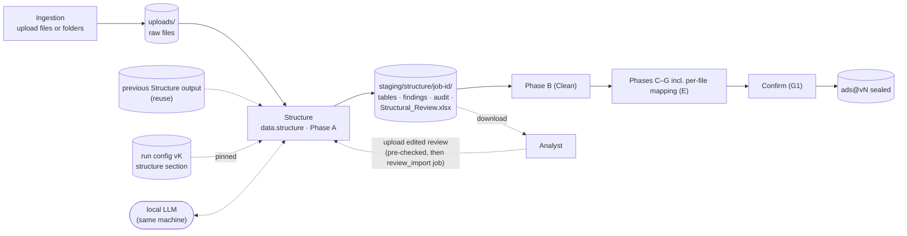
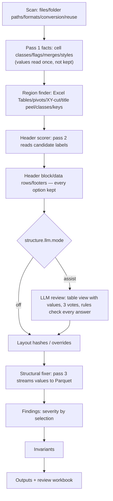

# Spec DP-A — Structural Intake (Phase A: Source File & Structural Intake)

> **Status:** Proposed · **Version:** 0.3 · **Series:** Data Pipeline phase spec A of 7 (A–G)
>
> **This is a new microservice — nothing below it exists yet.** The old `data_quality_agent` repository (Step 1: `excel_reader`/`fast_excel_reader` → `structure_detector` → `remediation_engine`), the *New DQ Pipeline Workflow* document, the *Structural Issues Checklist* and the MMM Architecture doc are reference material only, borrowed from where useful — never a contract this spec must reconcile with.
>
> **Produces:** one structured table (Parquet) per real data region of every uploaded file, each row with a stable `Row_ID`; the choice of which tables feed each source; structural findings and action items; an audit of every structural change; `Structural_Review.xlsx`. Phase B (Clean) reads the selected tables, not the raw files.

---

# 1. Scope

**In scope (V1).** A new job type, `data.structure`, run as the first processing step (Structure), after an upload-only Ingestion interface (§2.1):
- File intake for every file of every non-excluded source — single files, multiple files, or whole folders (folder paths kept) — and every worksheet in every workbook, hidden ones included (E-12).
- Formats: CSV, TSV, TXT, XLSX, XLSM, XLS, XLSB, ODS, Parquet (§3.1).
- Metadata-first extraction (E-13): layout is worked out from cell types/flags/structural text; everything reaching the control plane (Postgres, events, logs, action items) is value-free. Data values are read only to write the tables, by the local LLM, and by authorised users through preview/review workbook.
- Structural detection and fixes S-01 to S-28 (§6).
- Finding every table in a sheet (above/below/beside each other), its header rows, data rows and footers; writing each as Parquet.
- Table selection: which detected tables feed each source; files of a source may differ in layout, grouped by layout for later per-file mapping (§8.4).
- LLM review: a local model reads each table with its values and votes on structural decisions the rules already generated as options (§5).
- Findings, action items, a structural audit, and the Analyst review loop (`Structural_Review.xlsx`, download → edit → upload, §10).
- Incremental reuse: unchanged files are copied from the previous Structure output.

**Out of scope.**
- **Changing values.** Types, number formats, decimal/thousands separators, null tokens (`"N/A"`, `"-"`, `"null"`), whitespace, duplicates, outliers, date parsing — Phase B. Phase A writes what the file stores (Principle P1).
- **Mapping columns** to the plugin schema and dimension values — the per-file mapping step, Phase E. Phase A only feeds it (§9.6, §8.4).
- **Unpivoting** wide time layouts (years/months across columns) — flagged (`wide_time_layout`), left as-is.
- **Evaluating formulas.** The file's stored result is used; when absent, S-26 is raised and nothing is computed.
- **Archives** (ZIP etc.) and any format outside §3.1.
- Connectors/API feeds — reserved seam only (§2.4); V1 is file upload.
- Building the client report PDF — Phase A only marks findings `client_report: true`; a later Gate (after Phase D) collects Phases A–D's items and builds it.
- Vision/multimodal models.

### 1.1 Terms

| Term | Meaning |
|---|---|
| Populated cell | Text (len ≥ 1, whitespace-only included), a number, date, boolean, error, or formula (even without a stored result). Empty-string cells, styled-empty cells, non-anchor merge cells are not populated. |
| Used range | Bounding box of a sheet's populated cells (A1 notation). The file's `<dimension>` is recorded, never trusted. |
| Region | A rectangular block of populated cells from the region finder (§4.2). Class: `table`, `title`, `key_value`, `notes` or `fragment`. |
| Table | A region with header (or explicitly none), data rows/columns, written as one Parquet file. Source: region finder, Excel Table, pivot, or override. Identified by `table_ref = {file_key}:{sheet_index}:{table_key}` (§8). |
| Placement | A populated cell not part of any table (title, note, footer, fragment...). Written to `cells.parquet` — nothing disappears (Invariant I-01). |
| Selected table | A table chosen to feed a source (§8.5). Only selected tables go to Phase B; only findings on selected tables raise `warn`/`block`. |
| Finding | One detected condition: code (S-xx or named code), severity, location, counts. |
| Action item | A finding sent to the platform in the `succeeded` event. |
| Structural text | File/folder names, sheet names, header/group/unit-row labels. This is the only text E-13 allows as metadata. Titles, notes, key-values and all other data are not structural text. |
| Value-free artifact | Holds no cell values — only structure, counts, coordinates, structural text. Only these may reach the control plane. |
| Layout | A table's column names, normalised (trimmed, lower-case, inner whitespace collapsed). Tables sharing normalised names share a `layout_id` (§8.5). |
| Rule pack | `structure@x.y.z`: scorer weights, lexicons, severities, message templates — versioned, pinned per run like other rule packs. |

---

# 2. Architecture

### 2.1 Ingestion vs. Structure

**Ingestion is upload only.** The Analyst creates sources and uploads files/folders; nothing is parsed or mapped, no job runs. **Structure is the first processing step**, turning every uploaded file into clean tables and handing selected ones to Phase B. Reasons this is its own job rather than folded into ingest read-options: (1) nothing downstream can start without structure — with titles, multi-row headers and multiple tables per sheet, column names don't exist until Phase A runs; (2) a sheet name + header row (plain read options) can't express side-by-side tables, header groups, excluded footers, per-table ranges; (3) Phase A needs its own review loop with `block` items (password-protected file, formulas without results) settled before Phase B starts; (4) it is cheap to repeat — selection changes and review imports re-run Structure, and unchanged files are reused (§11.5 of Job Contract, §9).

Mapping happens later, per file (or per layout group): client files don't all share a layout, so each layout group gets its own column mapping in the mapping step (Phase E); Structure provides column names, types, samples and layout groups (§9.6, §8.5).

### 2.2 Flow



Structure is an independent job under the Job Contract (§11): reads raw files + pinned config, writes only under its own `output_prefix`. For now the service, its object storage and its LLM all run locally on one machine — production changes are tracked separately and don't affect this spec's contract. Its output is staging data; nothing is sealed until Confirm (G1). **Run remaining steps** starts at Structure.

### 2.3 Components

| Component | Responsibility | LLM? |
|---|---|---|
| File Scanner | Enumerate files/folder paths/sheets; detect format from bytes; convert XLS/XLSB/ODS to XLSX (§3.1, §4.1) | No |
| Metadata Extractor | Streaming reader; pass 1 reads cell types/flags only (§4.1–§4.2) | No |
| Structural Map Builder | Region finder, header scorer, header block, footers — builds every candidate (§4.2–§4.5) | No |
| Map Validator + Fallback | Local LLM reviews every table with data values and votes; rules check every answer; rules alone when LLM off/failed (§5) | Yes, constrained |
| Issue Deriver | S-01 to S-08 from the structural map (§6) | No |
| Excel Feature Checks | S-09 to S-28 from workbook parts — tab drift, merges, hidden rows/cols/sheets, outlines, panes, filters, print areas, conditional formats, data validation, named ranges, pivots, Excel Tables, protection, sheet names, formulas, drawings, comments (§6) | No |
| Structural Fixer | Deterministic per-table steps (§4.7); no per-fix LLM calls | No |
| Audit Writer | One entry per action+range, deterministic ids, A1 coordinates (§9.5) | No |
| Table Selector | Assigns tables to sources (§8.5) | No |
| Review Exporter/Importer | Structural_Review.xlsx round trip (§10) | No |

### 2.4 Principles

| # | Principle | Rules out |
|---|---|---|
| P1 | **Shape, never values.** Phase A may find, move, split, drop (empty columns only) and name. Never edits a cell value on its own; writes the stored value, not displayed text. Two recorded exceptions: merged label cells copied across their range (S-10), Analyst cell edits from the review workbook (§8.7). | Null-token conversion, trimming, type coercion, dropping sparse columns, filling numbers across merges |
| P2 | **Excel A1 coordinates everywhere** — rows 1-based, columns letters, in every JSON, finding, audit entry, `Row_ID`. CSV uses record/field numbers the same way. | Reader-relative or 0-based indices |
| P3 | **All data is read.** Hidden rows/cols/sheets, filtered rows, collapsed groups, cells outside print area — read like any other; visibility is a flag, never used to drop anything. | Cropping to print area, filter, or visible cells |
| P4 | **Rules own coordinates; the LLM chooses among them.** Every boundary/row/column comes from the rules. The LLM picks between the rules' options; answers are voted and checked (§5.6). | LLM-invented rows, ranges, issue codes, actions |
| P5 | **Nothing is dropped silently.** Every populated cell ends in exactly one place: table header, table row, or placement in `cells.parquet`. Invariant checked per sheet (§4.9). | Discarded preambles/footers, sheets that failed to parse |
| P6 | **Reproducible.** Same file bytes + config version + rule pack + LLM pin + example library ⇒ byte-identical data outputs and action-item ids; only job bookkeeping differs. LLM answers are stored and replayed within a run (§5.7); a separate run asks afresh. | Random ids, wall-clock values in outputs, unpinned models, unreplayed answers |
| P7 | **Value-free outside the data plane.** Only structure, counts, coordinates, structural text reach Postgres/events/logs/action items. The LLM reads values at the Analyst-set privacy level; prompts never stored/logged. | Cell values in messages, logs, detection JSON, stored prompts |
| P8 | **Streaming and bounded.** Memory depends on sheet width and a small row window, not sheet length. | Loading whole workbooks into DataFrames |

### 2.5 Seam for future connectors

Structure's output is the seam for a future connector/API source (out of scope for V1): downstream of Structure a source is a set of selected tables in one shape — `data.parquet` + `Row_ID`, `columns.json`, `samples.json` (§9). A future connector adapter would write the same shape and skip layout detection, same as a Parquet upload does now (§3.3); nothing from Phase B onward would change. Reuse of unchanged data for a connector needs its own test (extraction window/watermark) instead of the file hash of §11.5. Connector credentials are a job-contract extension not built here. The cube (`ads@vN`) is written by `data.build_ads` at G1; Phase A never writes to it, but every `ads` row traces to a source cell through `Row_ID` (§8).

---

# 3. Inputs

### 3.1 Files and formats

Every `ready` file of every non-excluded source is read. Format is decided from bytes; extension is only a hint.

| Detected content | Treated as | Handling |
|---|---|---|
| ZIP with `xl/workbook.xml` (content type `…sheet.main+xml` or `…sheet.macroEnabled.main+xml`) | XLSX, XLSM | Read directly (§4.1). Macros never executed/read; `macro_enabled: true` in inventory |
| ZIP with `xl/workbook.bin` | XLSB | Converted to XLSX, then read |
| OLE2 compound file with `Workbook`/`Book` stream | XLS (BIFF 5–8) | Converted to XLSX, then read |
| ZIP, `mimetype = application/vnd.oasis.opendocument.spreadsheet` | ODS | Converted to XLSX, then read |
| OLE2 with `EncryptionInfo`+`EncryptedPackage`, or XLS with `FILEPASS` | Password-protected | `password_protected` (block): remove password and re-upload |
| `PAR1` magic at both ends | Parquet | Skips Structure entirely — listed from footer, passed on unchanged (§3.3) |
| Text: BOM, valid UTF-8/UTF-16, or single-byte without NUL | CSV/TSV/TXT | §3.2 |
| Any other ZIP (archive), or other binary (PDF, image, ...) | — | `unsupported_format` (block); for an archive: "Upload the folder, or the files, instead" |

**Converting XLS/XLSB/ODS.** First converted to XLSX in the job's scratch space with LibreOffice headless, pinned to one version in the pipeline image: recalculation on load is off (stored formula results kept exactly, formulas never evaluated); macros disabled; converter has no network access, a 5-minute timeout, its own process limits (§11.7); the converted copy is used for reading only — `file_key`, content hash and every output reference stay those of the original upload, `converted_from` records the source format; `format_converted` (info) names features the conversion may approximate (conditional-format rules and data-validation formulas may be rewritten, drawings may shift, ODS has no Excel Tables); a conversion that fails or times out raises `file_unreadable` (block) for that file only.

**Other rules.** Upload size limits: 200 MB for every spreadsheet format (XLSX/XLSM/XLSB/XLS/ODS), 5 GB for delimited text and Parquet. Extension vs. content mismatch → content wins, `file_format_mismatch` (info). 0-byte file or no populated cell anywhere → `file_empty` (block). Unparseable file → `file_unreadable` (block) for that file only; other files still processed. File SHA-256 checked against job-input `content_hash` before anything else; mismatch → job fails `input_hash_mismatch` (not retryable).

### 3.2 Folder uploads (E-12)

Single files, several files at once, or a whole folder with subfolders. A folder is uploaded as its files: browser sends each with its relative path (e.g. `media/2026/Q1/tv_jan.xlsx`); the platform stores the path with the file and passes it in the job input; Phase A carries it into the inventory and every finding. No archives — ZIP etc. refused at upload, `unsupported_format` if one arrives anyway. OS clutter in a folder (`.DS_Store`, `Thumbs.db`, `~$*`) is skipped by the upload interface. A file whose content equals another file of the same source is refused at upload; a folder upload lists such files as skipped duplicates and uploads the rest.

**Inventory** (§9.3) lists every file and sheet: source, file id, relative path, format, conversion, size, content hash, `file_key`, and per sheet: index, exact name, `sheet_key`, visibility, used range, region counts. Sheets with no table are listed too — any output row traces to file/folder/sheet/cell through `Row_ID` (§8).

### 3.3 Parquet uploads

Parquet **skips Structure entirely**: already a single typed table, not converted/analysed/rewritten. Structure reads its footer (schema, row count) into the inventory. Listed as one table `t1` whose data is the upload itself — its inventory entry carries `data_ref` (the raw object) instead of `data.parquet`; no sheet JSON, no `cells.parquet`, no audit. `columns.json` is written from the schema; schema names are the labels, named per the naming rules of §4.6 (trimmed, `_`-prefixed with `src`, case-insensitive duplicates numbered `__2`...); the column names form the file's layout (§8.5). `samples.json` from the first 10,000 rows. Phase B reads the raw file through `data_ref`, uses `columns.json` names, and gives each row `Row_ID = {file_key}:0:t1:{row}` (1-based). Selected like any table (§8.5), auto-selected when it's its file's only table. In the review workbook only **Use** is editable on its Structural_Findings row; no table sheet, no cell edits; overrides on it are refused (`422 structure_override_invalid`).

### 3.4 Job submission

Every object the job reads is listed in `inputs` with its full prefix:

```json
{
  "job_id": "j-5001", "job_type": "data.structure", "attempt": 1,
  "context": {"tenant_id": "t-123", "project_id": "p-456", "run_id": "r-789"},
  "inputs": [
    {"ref": "…/uploads/u-31/tv_2026.xlsx", "content_hash": "sha256:3f9c2a7b1e04…",
     "kind": "raw_file", "source_id": "s-1", "file_id": "f-11", "relative_path": "media/tv_2026.xlsx"},
    {"ref": "…/config/v8.json", "content_hash": "sha256:…", "kind": "config"},
    {"ref": "…/staging/structure/j-4990/", "content_hash": "sha256:…", "kind": "previous_structure"},
    {"ref": "…/library/structure_examples/v14.jsonl", "content_hash": "sha256:…", "kind": "examples"}
  ],
  "output_prefix": "t-123/p-456/r-789/staging/structure/j-5001/",
  "params": {
    "mode": "run", "plugin": "mmm@1.2.0", "rule_packs": {"structure": "1.0.0"},
    "config_ref": "…/config/v8.json", "full": false,
    "llm": {"model": "qwen2.5:7b-instruct", "model_digest": "sha256:…", "prompt_version": "structure-choice/2"}
  },
  "callback_url": "…", "job_token": "<JWT>",
  "storage": {"endpoint_url": "…", "bucket": "…", "access_key": "…", "secret_key": "…", "session_token": "…", "expires_at": "…"},
  "deadline": "…"
}
```

- `params.mode`: `run` (default) or `review_import` (§10.2) — an import job also receives `kind: review_upload`.
- `params.full = true` turns off per-file reuse (§11.5) — the **Re-run all** button.
- LLM model/digest/prompt version are pinned on the run like rule packs — the model shown is illustrative only; the pinned model is the one passing the benchmark of §5.8.
- LLM settings (mode, privacy level, votes, review scope) come from config (`structure.llm`, §8.1); the Analyst sets them per run on the Structure screen.
- The LLM endpoint is the service's own setting, `STRUCTURE_LLM_URL`, defaulting to local Ollama `http://localhost:11434` (§5.2) — not carried in the job.
- `kind: examples` = the project's example library (§5.6): value-free records of past Analyst corrections, used as few-shot examples; optional — without it, the job uses the rule pack's built-in examples.

---

# 4. Processing



Files processed in parallel (up to 4/job); sheets of a file sequentially. Order never changes output: files by `(source_id, relative_path)`, sheets by workbook order, every output list sorted.

### 4.1 File Scanner & workbook reader

1. Verify each file's hash against job input.
2. Sniff format from bytes (§3.1); archives/unknown stop here with `unsupported_format`.
3. Compute `file_key` = first 12 hex chars of content SHA-256 of the original upload (§8).
4. Decide reuse (§11.5); a reused file is copied from the previous output, skipping steps below (conversion included).
5. Convert XLS/XLSB/ODS to XLSX in scratch space, raise `format_converted`; converted copy read from here on, references stay original.
6. For workbooks: list sheets in `workbook.xml` order with 0-based `sheet_index`, exact name, `sheet_key` (S-24), state (`visible`/`hidden`/`veryHidden`); locate each sheet's part via workbook relationships.

**One reader** (XLSX/XLSM/converted files) handles facts and values in Excel coordinates, streaming OOXML parts with `lxml.iterparse`, clearing each element once processed — not calamine, not pandas (mixing readers with different coordinate origins caused a known defect, K-01, §12). XML parsing hardened: no DTDs, no entity expansion, no network. Cells without an `r` attribute get their coordinate from row position.

**Parts read:** `xl/workbook.xml` (sheets order/name/sheetId/state; `definedNames` for print areas S-17 and names S-20; `workbookPr date1904`; `calcPr fullCalcOnLoad` for S-26; `workbookProtection` S-23) · `xl/_rels/workbook.xml.rels` (sheet paths; external-link parts, S-26) · `xl/styles.xml` (`cellXfs`→number format, custom `numFmts`, fonts/fills for S-18 static hiding, `dxfs` for S-18 conditional hiding) · `xl/theme/theme1.xml` (theme colours for S-18) · `xl/sharedStrings.xml` (shared strings, rich-text runs joined; kept in memory to 512 MB, else on-disk index) · `xl/worksheets/sheetN.xml` (cells; rows `hidden`/`outlineLevel`/`collapsed`; columns as ranges `hidden`/`outlineLevel`; `mergeCells`; `sheetViews/pane`; `autoFilter`+criteria; `sheetProtection`; `conditionalFormatting`; `dataValidations`; `dimension` recorded not trusted) · sheet-rel table parts (Excel Tables: name/ref/headerRowCount/totalsRowCount/column names, S-22) · pivot/cache parts (location, cache source, `refreshedDate`, `refreshOnLoad`, S-21) · drawing parts (chart/shape/picture anchors, S-27) · comment/threaded-comment parts (S-28) · `xl/externalLinks/…` (which external workbooks formulas point to, S-26).

**Pass 1: facts.** Each cell read once, reduced to a class + flags, value discarded. Per populated cell: row, column, class, style number-format class, flags (formula, stored-result-present, merged-anchor, whitespace-only). Shared-string indices stand in for text identity (measure label uniqueness without keeping text). This is the E-13 metadata-only step; the region finder and header scorer work from facts alone; the LLM view adds values on top (§5.4).

Cell classes (non-text, by type): `F` formula with no stored result; `E` error (`t="e"`); `B` boolean; `D` ISO date cell or number with a date/time format; `N` any other number; `P` instead of `N` when a whole number 1900–2100 (as number or numeric-looking text) has ≥2 such numbers ascending in the same row (year header e.g. `2023 · 2024`).

Text classes, first rule that matches wins:

| Order | Class | Rule |
|---|---|---|
| 1 | `W` whitespace | Whitespace only — populated, never header evidence |
| 2 | `D` date | Full date w/ or w/o time: `2025-01-01`, `01/02/2025`, `2025-01-01 10:00` |
| 3 | `P` period label | Month/quarter/week/half-year/fiscal token: `Jan`, `January`, `Jan-25`, `2025-01`, `Q1 2025`, `W05`, `H1`, `FY25` (`M1` is NOT a period token) |
| 4 | `N` number | Numeric-looking: `1,234.50`, `12%`, `(1 200)`, `1.2E3`, `12.50` |
| 5 | `E` error | Error literal typed as text: `#N/A`, `#REF!`, … |
| 6 | `T` long text | >60 chars trimmed, a URL, or an e-mail address |
| 7 | `L` label | Anything else; `TRUE` as text is `L` |

`L`/`P` are *label classes*; `N`/`D`/`B`/`E`/`F`/`T` are *data classes*.

**Pass 2: labels and LLM view.** Reads label-class cell text in header-candidate rows (≤12/region) and group rows, for scoring. With LLM on, also reads each reviewed region's LLM view (§5.4): first 30 + last 5 rows, each value cut to 32 chars, at the Analyst's privacy level. That text goes only to the local LLM, dropped after the call returns; only the rows that end up as header/group/unit rows (structural text) may leave the data plane.

**Pass 3: extraction.** Streams the sheet again, writes table rows to Parquet in batches of 50,000; writes placements/annotations to `cells.parquet` (§9.7).

**Canonical rendering.** `data.parquet` stores every table cell as text in one fixed rendering — no information lost or invented:

| Source cell | Written as | Also recorded |
|---|---|---|
| Shared/inline/rich-text string | Exact text: no trim, no case change, no null tokens; OOXML escapes (`_x000D_`) decoded | — |
| Empty string | `NULL` (not a populated cell) | — |
| Number, General/numeric format | Shortest decimal round-tripping to the stored double (`99999999.98999999`→`99999999.99`, `45658`→`45658`); plain notation for 1e-6≤\|x\|<1e15, else `1.5E-07` | Number format code |
| Number with date/time format | ISO 8601, rounded to ms. Date-only → `2025-01-01`; date+time → `2025-01-01T10:00:00`; time-only → `10:00:00` (fractional part, any serial). 1900 system: serials 1–59 map as Excel does; serial 60 (non-existent 29 Feb 1900) written as a number. 1904 system: serial 0 = 1904-01-01. A serial below the system's first day, or after 31 Dec 9999 (2,958,465 in 1900 system / 2,957,003 in 1904 system) is written as a number | `date_out_of_range` annotation |
| Number, elapsed-time format (`[h]:mm`) | As a number (duration in days) | Format code |
| ISO date cell (`t="d"`) | Normalised to ISO 8601 | — |
| Boolean | `TRUE`/`FALSE` | — |
| Error | The literal, e.g. `#DIV/0!` | `error` annotation |
| Formula, stored result | The stored result, rendered by type | Formula counts (S-26) |
| Formula, no stored result | `NULL` | `formula_uncached` annotation (S-26) |

A number is never rendered from display format — `0.05` formatted `5%` is written `0.05`, format code `0%` recorded (P1).

### 4.2 CSV, TSV, TXT and Parquet parsing

Parsed into the same grid as a sheet (sheet index 0; rows = record numbers; columns = field positions as letters) so region finder and header scorer run on them too (the old pipeline skipped structural detection for CSV entirely — defect K-20).

- **Encoding.** BOM decides first (UTF-8, UTF-16 LE/BE). Else UTF-16 without BOM recognised by NUL-byte density: ≥90% of odd bytes (LE) or even bytes (BE) NUL in first 4 KB. Else whole file checked as UTF-8. Else a charset detector chooses among single-byte encodings; `csv_encoding_guessed` (info) records choice+confidence. Analyst can override (`structure.read`, §8.1).
- **Delimiter.** Sniffed from first 64 KB among `,` `;` tab `|` — winner gives most consistent field count across sampled records (≥2 fields); ties go to `,`. Overridable.
- **Parsing.** Quote `"`, escaped by doubling; a quoted field may span lines (unit = record, not line); CRLF/LF/CR all accepted.
- **No value interpretation.** Every field stays text; empty fields (quoted or not) → `NULL`; no null tokens, no date parsing, no coercion — separators are Phase B's job.
- **Ragged records kept.** Short record → `NULL` in missing trailing fields (`ragged_short`). Long record → extra fields become extra unlabelled columns (named by letter like `col_F`), `ragged_long` annotation + `csv_ragged` finding. No record ever skipped.
- Classes are lexical (§4.1's text rules).
- **Bounded memory.** Region finder/header scorer look at first 10,000 and last 1,000 records (where preambles/headers/footers live); body streamed once to count fields and empty records. Only when the body holds a run of ≥ `row_gap` empty records (a second table) does the region finder make a full pass.
- A field >1 MB, or a record >16,384 fields, raises `file_unreadable` (block) for that file.

### 4.3 Region finder

Turns a sheet's populated cells into regions, working on facts only, in 3 stages: **detection+keys** by rules (steps 1–6 below), **LLM review** (§5, may change classes/cuts/headers/footers but never renumbers a rules-assigned key), then **layout hashes + overrides** (step 7). Neither the LLM nor an override ever changes another table's key.

1. **Excel Tables first (S-22).** Each Excel Table's `ref` carved out as a table (`source: excel_table`), header from the table part. Populated cells continuing the pattern directly below/right of `ref` raise `table_object_mismatch` (S-22) and become their own region — never dropped, never silently merged.
2. **Pivots (S-21).** Each pivot's location range carved out (`source: pivot`); header/data rows from `firstHeaderRow`/`firstDataRow`/`firstDataCol`. Pivots never auto-selected (§8.5).
3. **Rows directly above a carved table**, within its columns: checked one-by-one going up, each against the title rule first (step 4.1, with the table+attached rows counting as the next populated row) then the group-row rule (§4.5). A title stops the climb; a group row attaches to the table.
4. **XY-cut** on what remains — a merged range occupies its whole extent for cut detection. Recursively, per block:
   1. **Peel title rows, tentatively.** A top block row is a title when it has exactly 1 populated cell (a merged range counts once) and the next populated row has ≥2. Up to `max_title_rows` (10). Kept only if the rest of the block yields ≥1 `table`, else undone and re-cut without peeling. (Peeling first matters: a full-width title would otherwise block the vertical cut between side-by-side tables below.) Kept titles become `title` placements.
   2. **Hard cuts.** A run of ≥ `row_gap` (2) fully empty rows, or ≥ `col_gap` (2) fully empty columns, across the block. Widest gap cut first; ties: rows before columns, then top-most/left-most.
   3. **Soft cuts.** A single empty row/column cut only if the two sides differ in extent by ≥2 (columns for row cut, rows for column cut), OR the far side alone would classify as a table **with a header** (step 5, rule 4). A headerless far side never justifies a cut. A row is never cut when every far-side row is a footer of the near side (§4.6). A single uncut empty row is an aesthetic gap (S-08); a single uncut empty column is padding (S-05). Rows tried before columns, top-most/left-most first. Can be disabled (`structure.params.soft_cuts`).
   4. Repeat until no cut applies.
5. **Classify each leaf, first match wins:**

   | Order | Class | Rule |
   |---|---|---|
   | 1 | `notes` | 1 effective column, ≥60% of cells are text of ≥3 words |
   | 2 | `fragment` | Fewer than `min_table_cells` (4) populated cells, or a single row |
   | 3 | `key_value` | 2 effective columns, ≤20 rows, left column all `L`, no header candidate reaching `header_min_score` |
   | 4 | `table` | A header candidate reaches `header_min_score`, and ≥ `min_data_rows` (1) rows follow the header block |
   | 5 | `table`, no header | ≥2 rows, ≥2 columns, ≥80% of each column shares one class — columns named by letter, `S-01 no_header` raised |
   | 6 | `fragment` | Anything else |

   Within a `table` region, non-group rows above the header block become placements row by row: 1 populated cell → `title`; label+value pair → `key_value`; anything else → `preamble`.
6. **Keys.** Rules' tables ordered by top row then left column, keyed `t1`, `t2`, … The LLM review then works on these: a table the LLM reclassifies gives up its key (never reused); when the LLM refuses a cut, the merged table keeps the near side's key and the far side's key is retired; a table the LLM *creates* (a reclassified region, the far side of an LLM cut, or a table from a re-cut round on an LLM-changed block) gets an `a` key (`a1`, `a2`, … in reading order among the sheet's LLM-created tables); a changed header/footer never changes a key. A selector naming `t2` therefore always means the table the rules found second, whatever the model answers; if the LLM retired that key, the selector fails visibly (`selection_not_found`, with `assistant_decision` saying why, §5.6).
7. **Layout hashes, then overrides.** After review, each table's layout hash (range, header rows, labels) is computed; only then are overrides (§8.6) applied: `status: not_table` turns a table's cells into `excluded_table` placements; a `range`/`header_rows`/`exclude_rows`/`exclude_columns` override replaces that table's detected value, keeping its key; a new table (keyed by its override's `o` key) takes its range's cells from any other region — a detected table left without cells forming a `table` gives them up as placements (key not reused). Removing an override never renumbers another.

**Effective width/height** count only columns/rows holding ≥1 populated cell; the region's *range* stays the full bounding box.

**Sheet-level findings:** S-06 when empty share of used range > `sheet_sparsity_pct` (50); S-07 when >1 table region; `sheet_no_table` (info) when none.

### 4.4 Header scorer

One scorer ranks header options, serves as the fallback, checks LLM answers, and fills the review workbook. First `max_header_scan_rows` (12) populated rows of a region, after title peeling, are candidates:

| Feature | Definition | Weight |
|---|---|---|
| Coverage | Populated cells in row ÷ effective width (merged continuation cells don't count) | +3.0 |
| Label share | Label-class cells ÷ populated cells in row | +3.0 |
| Uniqueness | Distinct label texts ÷ label cells (0 if none) | +1.0 |
| Type break | Share of row's label-class cells whose column's dominant class in the next ≤5 populated rows is a data class (over columns populated below) | +3.0 |
| Data share | Data-class cells ÷ populated cells in row | −3.0 |
| First row | Row is the region's first candidate | +0.5 |
| Freeze | Sheet has frozen rows and freeze ends at this row (`ySplit`=row); S-15 as evidence | +1.5 |
| Lexicon | Cells with a word from the plugin's header lexicon (MMM: date, week, month, spend, cost, impressions, clicks, channel, campaign, region, geography, brand, product, sales, revenue, …), max 3 | +0.5 each |
| Time header | ≥3 `P` cells in the row (wide time layout) | +3.0 |
| Single cell | Exactly 1 populated cell in a region >2 columns wide | −3.0 |

**Decision.** Best candidate is header if score ≥ `header_min_score` (4.0); ties → upper row. Best/runner-up within `header_tie_margin` (1.0) → **near-tie**; with LLM on and `review: all`, reviewed anyway (§5.3), `S-01 uncertain_header` raised per §5.6. An Excel Table/pivot header comes from its part (authoritative); scorer still runs for comparison only. An Analyst override wins over everything. Weights/lexicon are part of the rule pack — changing them is a new rule-pack version, never a run setting.

### 4.5 Header block and column names

Once header row `h` is chosen:
- **Group rows (S-03).** Up to 2 rows directly above `h`, no empty row between, are group rows when all populated cells are label class, each either anchors a merge spanning ≥2 columns or is followed by blanks up to the next label, and the row has fewer distinct labels than `h`. A single-populated-cell row is a group row only if its span covers part of the header's width (one covering the whole width is a title). Each column gets its list of groups, top-down.
- **Unit row (S-03).** Row `h+1` is a unit row when all populated cells are short (≤12 chars) unit tokens from the rule pack (`INR`, `USD`, `€`, `%`, `units`, `'000`, `(000s)`, `k`, `mn`, `cr`, `lakhs`, …) and row `h+2` is data. Each column gets its unit.
- **Second header row (S-03).** Row `h+1` is part of the header when label class, covers ≥half the effective width, and row `h+2` is data — header rows become `[h, h+1]`, `h` acting as the group level.
- **Labels and names.** Each column keeps `label` (exact header text, lowest header row) and `name` (label, whitespace-trimmed, inner runs collapsed to one space — no case folding, no character stripping).
- **Composite names**, only when needed. `name` = lower label if non-blank and unique (case-insensitive) in the table; else nearest group prefixed (`{group}_{label}`, separator configurable), then next group up, until unique. Groups are always recorded, composed or not.
- **Blank labels.** Populated column, blank label, no group → named by letter `col_K`, `S-01 blank_header` (info); with a group → `{group}_col_K`.
- **Duplicates** after composition get `__2`, `__3`, … in column order, `S-03 duplicate_header` (info).
- **Numbers/dates as labels.** A year header `2023` is named `2023`; a date header named by its canonical rendering (`2025-01-06`) — never replaced by `Col_N`. A row of period labels raises `S-03 wide_time_layout` (info) — not unpivoted (Phase E handles it).
- **Reserved names.** Every name beginning `_` is reserved for system columns (§9.5); a source label beginning `_` gets prefix `src` (`_id`→`src_id`).

### 4.6 Data rows, gaps and footers

Data rows run from the row after the header block (and unit row) to the table's last populated row. Footers decided first, then gaps.

- **Footers.** With `rules.footers.enabled` on (default), up to 5 trailing rows checked from the last upwards. A trailing row is a footer only when BOTH: (1) its first populated cell matches the footer lexicon (`total`, `subtotal`, `grand total`, `sum`, `average`, `note`, `notes`, `source`, `remarks`, …), or is a ≥3-word note after an empty row; AND (2) it breaks the column pattern (text in a column whose data cells are ≥80% numeric, or fewer than half the columns populated), or its numbers equal the column sums/averages of the rows above within 0.5%. Footers become `footer` placements; `footer_rows` (info) lists them. An Excel Table's totals rows are footers by definition (S-22) even with the rule off.
- **Gap rows (S-08).** Fully empty rows with data rows on both sides are removed (audit lists all removed rows). An empty row before a footer is not a gap — it separates the footer. Inside an XY-cut table only single empty rows can occur (longer runs are hard cuts); inside an Excel Table longer runs can occur and are removed the same way.
- **Interior totals.** A row inside the data matching the total lexicon whose numbers equal the sums since the previous such row is **kept**; `interior_totals` (info) lists these so the Analyst can exclude via override. Phase A never removes interior rows on its own.

### 4.7 Structural fixer

Per table, in this order; each step writes audit entries (§9.5). An Analyst override replaces the rule's decision at the step it's made:

| # | Step | Codes | What happens |
|---|---|---|---|
| 1 | Resolve table range | S-04, S-21, S-22 | Region, Excel Table/pivot range, or override range |
| 2 | Header block | S-01, S-03 | Header/group/unit rows chosen; labels/names/groups/units built (§4.5) |
| 3 | Preamble out | S-01, S-04 | Titles, key-value rows, notes above header become placements |
| 4 | Columns | S-02, S-05 | Only the table's own columns kept; a column dropped only if blank label **and** no populated data cell, and only with `rules.S-05.drop_empty_columns` on (default). Sparse columns always kept |
| 5 | Merged cells | S-10 | Header merges → groups. Data: text/date/boolean merges filled across range; numeric merges not filled (`numeric_merge`, warn). One audit entry per range |
| 6 | Footers and totals | S-22 | Footers and Excel Table totals rows become placements |
| 7 | Gap rows | S-08 | Empty rows with data on both sides removed |
| 8 | Overrides and edits | — | `exclude_rows`/`exclude_columns` applied (cells become `excluded_row`/`excluded_column` placements), then cell edits (§8.7) |
| 9 | Write | — | `data.parquet`, `columns.json`, `samples.json`, annotations |

Hidden/filtered/grouped rows, cells outside print area, and protected sheets change nothing in these steps (P3) — recorded as flags and findings.

S-09 to S-28 (Excel feature checks, §6) are read from workbook parts and specified per-code in §6; only S-10 (merged labels) and S-22 (table range) change a table. No LLM involved in any of them.

### 4.8 Invariants

Checked per file before any output is written. A violation of I-01–I-06 **fails the job** (`invariant_violation` — a pipeline bug; writing wrong tables would be worse than failing):

| # | Invariant |
|---|---|
| I-01 | **Cell accounting.** Every populated cell of every sheet is exactly one of: header/group/unit-row cell of a table, data cell of a table, or a `cells.parquet` placement. Per-sheet counts sum to the pass-1 populated-cell count. A `sheet_error` sheet is recorded as unread instead (§6) |
| I-02 | **Value fidelity.** Every table data cell equals the canonical rendering (§4.1) of the source cell, except `merge_fill`/`analyst_edit` cells |
| I-03 | **Coordinates.** Every table cell/placement lies inside the sheet's used range; every other coordinate (declared dimension, drawing extents, comment anchors, name targets, hidden ranges) is a valid A1 reference within Excel's grid. CSV: record/field numbers exist in the file |
| I-04 | **Row_ID.** Unique within the table, matches §8's pattern; `_source_row` strictly increasing |
| I-05 | **Names.** Column names unique within table (case-insensitive), non-empty; none begins `_` except system columns |
| I-06 | **Non-empty tables.** Each table has ≥1 column and ≥1 data row; an emptied-out region reclassifies as `fragment` with a finding |
| I-07 | **Value-free metadata.** `inventory.json`, sheet JSON, `columns.json`, `report.json`, `llm/decisions.jsonl`, `llm/examples.jsonl`, events, logs, action items hold no text other than structural text; LLM prompts never written anywhere. Enforced by construction + canary tests (§14, criterion 31) |

---

# 5. The LLM Review

### 5.1 Role and accuracy levers

The rules find every region, row and column; the LLM is a *reviewer* — reads each region like an analyst would, values included, and chooses among the rules' options. It never proposes a row, range, issue code or action (P4). Reading values is what lets it get close calls right (e.g. `Jan-25` under `Month` is data not a second header row; a row starting `Total` is a sum of rows above; a block of names/amounts is a small table not a note) — so it is not limited to near-ties; with `review: all` (default) it reviews every table's header and every sizable region the rules didn't call a table.

Levers used to make its answers accurate rather than just occasional:

| Lever | How |
|---|---|
| Reads the data | At `full` (default) the view holds the region's first 30/last 5 rows with values, rows above it, both sides of a cut (§5.4) |
| Only chooses | Every answer is an option id from the rules; the response schema lists options as an enum — no answer outside them (§5.5) |
| Reviews every table | Not just close calls: every detected table's header, every sizable non-table region, every borderline cut/footer (§4.3) |
| Gives a reason first | Each answer carries a short reason before the choice (forces looking at evidence); reason used only in memory, never stored |
| Votes | 3 by default, each with options in a different order and a different seed. A header can change on plain majority only when the rules' own call was a near-tie; any other change against the rules needs unanimity (§5.5, §5.6) |
| Judges independently | The rules' choice/scores are never shown — agreement means two methods agree |
| Learns from corrections | Up to 3 worked examples per call, nearest from the project's Analyst corrections + the rule pack's built-in set; an already-corrected question gets the correction directly (§5.6) |
| Is checked | Every answer must pass the rules' checks; every disagreement on a selected table goes to the Analyst (§5.6) |
| Is measured | A benchmark picks the model and gates every model/prompt change (§5.8) |

Motivating evidence for keeping the rules in charge of coordinates: the old repository's adversarial test recorded the model returning the wrong header row on 6 of 7 adversarial sheets when it built the map on its own — here it only *chooses*, and a wrong answer is caught by the checks, outvoted, or shown to the Analyst.

### 5.2 Where it runs

Locally: the pipeline calls a local Ollama server directly, `STRUCTURE_LLM_URL` (default `http://localhost:11434`) — no platform LLM orchestration in the path, no third-party API. **Loopback only** — the job refuses a non-loopback LLM URL unless the service is started with `STRUCTURE_LLM_ALLOW_REMOTE=1` (a misconfigured URL can't send client data off-machine). **Pinned** — model pinned by name+digest on the run; the job reads the digest from Ollama (`/api/show`) before its first call, and a mismatch counts as unavailable (§5.9); a different model is never used silently; Ollama version recorded with each decision. **Nothing kept** — prompts are built in memory and dropped after each call; never written to disk/logs/outputs; Ollama's own request logging is off.

### 5.3 Privacy levels

Set per run by the Analyst on the Structure screen; default `full` (accuracy + local-only model justify it). The rules never depend on the level.

| Level | View holds | Never in view |
|---|---|---|
| `full` (default) | Class grid with every cell's value (cut to 32 chars) for the view's rows; sheet name; file's relative path; up to 3 non-empty rows directly above the region | Comments (S-28); cells outside the view |
| `labels_only` | Class grid + text of label-class cells in header-like rows (rows scoring ≥ `header_min_score`) and group rows; sheet name | Every other value: data rows, titles, notes, key-values, non-header-scoring text |
| `structure_only` | Class grid only; sheet name replaced by `sheet_{index}` | Any text |

At `labels_only` a data row whose cells are all labels can score as a header, so its text can reach the model — never stored (P7). Accuracy drops as the level goes down; the benchmark (§5.8) measures it per level and the Structure screen shows the figures. Whatever the level, the control plane stays value-free (P7, I-07) — the level governs only what the local model reads.

### 5.4 The view of a region

One call covers one region and its open decisions of one round (≤5 per call, §5.3). **Rows:** first 30 + last 5 (all when ≤35), plus any option row outside those; for `soft_cut`, also 5 rows/columns each side of the cut and first 10 of the far side. Skipped rows summarised (e.g. "rows 36–4,998: 4,963 rows with the pattern of row 35"). **Columns:** at most 30 (first 24 + last 6, others summarised; for a column cut, 5 columns each side always shown). **Each row** shows its number, class line (one letter/cell: `L` label, `T` long text, `N` number, `D` date, `P` period, `B` boolean, `E` error, `F` formula w/o result, `.` empty, `~` merged continuation), and, at `full`, values; hidden/filtered rows marked. **Context:** sheet name, region range/size, frozen rows, nearby Excel Table/pivot boundaries, and at `full` the rows above the region. **Not shown:** the rules' choice/scores/margins (independent opinion). **Budget:** prompt kept under 12,000 tokens (16,384-token context) — a view exceeding it shrinks in steps: first rows to 20, then 12, values cut to 16 chars, columns to 16; rows around a cut and option rows are never dropped.

**Decisions per round** — a decision can change what the next is about, so asked in rounds per sheet (soft cuts → region classes → header rows → footers); after each round the accepted answers apply and affected blocks re-run through the rules:

| Decision | Options (always from rules) | Asked with `review: all` | Asked with `review: near_ties` |
|---|---|---|---|
| `header_row` | Each of first `max_header_scan_rows` (12) rows, plus `none` | Every region-finder table (not Excel Tables/pivots/override tables, whose header is fixed) | Best & runner-up within `header_tie_margin`, or best within 2.0 of `header_min_score` |
| `region_class` | `table` (≥2 rows+cols), `key_value` (2 cols), `notes` (1 col), `title` (1 row), `fragment` | Every non-table leaf with ≥8 populated cells; every table whose best header score is within 2.0 of `header_min_score` | Tables within 2.0 of `header_min_score` only |
| `soft_cut` | `split`, `no_split` | Sides' extents differ by exactly 1, or far side's best header score within 1.0 of `header_min_score` | Same |
| `footer` | `footer`, `data` | A trailing row passes exactly one of the two footer tests (§4.6) | Same |

Round repeats: after the soft-cut round, XY-cut re-runs on blocks a changed cut produced; new borderline cuts repeat the round up to 3 times, then rules decide. After the region-class round, affected regions are reclassified so an LLM-created table gets its own `header_row` question in the next round.

### 5.5 Request, votes, answer

`POST {STRUCTURE_LLM_URL}/api/chat`, not streamed, prompt template `structure-choice/2`, with examples (§5.6) and the view. Request options: `num_ctx` 16,384, `num_predict` 512, temperature/seed per vote. **Structured output:** Ollama `format` carries a JSON schema, one required property per decision id, each `{why: string ≤160 chars, choice: enum}` — a choice outside the options can't be produced, e.g. `{"d1": {"why": "...", "choice": "row:5"}}`.

**Votes.** `votes=3` (default): 3 calls, seeds 11/22/33, temperature 0.3, options listed in 3 orders (as-built, reversed, rotated-by-1) — option ids never change so votes compare. `votes=5`: seeds add 44/55, orders repeat. `votes=1`: one call, seed 11, temperature 0. **Limits:** 60 s/call, one retry on transport error or unparseable answer; after that, that vote counts as no answer. The `why` reason is read only to check an answer was given — never stored/logged (can quote values at `full`).

**Counting**, over votes *requested*: a choice is **majority** when >half name it (2/3, 3/5, 1/1) — failed votes count against every choice, so 3 requested + 2 failed ⇒ no majority. A majority is **unanimous** when every requested vote names it AND ≥3 were requested (a single vote is never unanimous). Any other majority is a **plain majority**.

### 5.6 Checking and accepting answers

Rules check every majority before it changes anything.

**Header validity.** A row is a valid header when: it's one of the options; ≥2 populated cells (or region is 1 column wide); ≥half its cells are label class; ≥ `min_data_rows` rows follow it; it's not a row the rules took as a footer. `none` is valid when the region meets the header-less-table rule (§4.3 rule 5).

**Gap and margin.** `S(r)` = row score. If rules chose row `h`: gap of row `r` = `S(h)−S(r)`; gap of `none` = `S(h)−header_min_score`; rules' margin = `S(h)` − best other row's score. If rules chose `none`: gap of `r` = `header_min_score−S(r)`; rules' margin = `header_min_score` − best row's score.

**`header_row` outcome table:**

| Votes | Outcome (`decided_by`) | Finding |
|---|---|---|
| Majority for rules' choice | rules' choice (`rules+llm`) | none (agreement) |
| Unanimous for another valid option with gap ≤ `llm_override_margin` (6.0) | LLM's choice (`llm`) | `uncertain_header` warn |
| Plain majority for another valid option, rules' margin < `header_tie_margin` AND gap ≤ `llm_override_margin` | LLM's choice (`llm`) | `uncertain_header` warn |
| Any other majority for another option (invalid, gap too big, or plain majority against a rules' margin ≥ `header_tie_margin`) | rules' choice (`rules`), `overruled` | `uncertain_header` warn |
| No majority / no answer | rules' choice (`rules`) | `uncertain_header` warn only on a near-tie |

**`region_class`, `soft_cut`, `footer`.** Plain majority for rules' choice confirms it. A choice against the rules applies only if **unanimous** AND shape allows: `table` needs ≥2 rows+2 effective columns and a valid header or valid `none`; `key_value` needs exactly 2 effective columns, `notes` exactly 1, `title` 1 row; `split` needs the far side ≥2 rows+2 cols and a header-valid row, `no_split` needs the two sides to form one table under the near side's header; `footer` needs the row among the table's last 5, `data` needs it to follow the column pattern. A unanimous choice the shape disallows, and any plain majority against the rules, is `overruled`. When an applied change touches a selected table, or retires a key a selector names, `assistant_decision` (warn) says what changed and why. Findings that go with these decisions (`soft_split`, `footer_rows`) are raised either way. Every LLM change is in the audit (`decided_by: llm`) and the review workbook's Findings sheet, undoable by override (§8.6) — an override always wins.

### 5.7 Example library

Each call includes up to 3 worked examples of the same decision kind. **Sources:** the rule pack's built-in examples (from the fixture suite) + the project's Analyst corrections. **Recording a correction:** when an override changes a header/class/range the LLM review decided (or the rules decided with the LLM agreeing), the job writes a record to `llm/examples.jsonl`: decision kind, layout, options, answer used, right answer; for `status: not_table` the right class is what the region rules give with table rules 4–5 left out. Record id derives from question hash + right answer (same correction ⇒ same id always). **The library:** on finalizing, the platform adds records the project's library (`{tenant}/{project}/library/structure_examples/`, new version each time) doesn't hold yet; every job receives the latest as `kind: examples`. **Value-free:** a record holds the view's class grid, structural text of header/group/unit rows once the correction applies, options, answers, question hash — no data values, value-free whatever the run's privacy level. **Corrections come first:** when the library holds a correction whose question hash matches (same view/options/privacy level/prompt version, whatever votes), its answer is used without calling the model (`decided_by: correction`, outcome `corrected`), checked like a unanimous vote; when it differs from the rules it raises the same finding as an LLM change but at **info** (an Analyst made the call). **Choice of examples:** nearest by layout (Jaccard similarity over class-line rows), preferring project corrections, ties by recency then id; at least 1 built-in example always included. **Size:** ≤500 corrections/project, oldest dropped first.

### 5.8 Decision record and reuse

Each decision is one line of `llm/decisions.jsonl` (value-free), e.g.:

```json
{"decision_id": "header_row@c41d09e7b2aa:0:B4:H40", "question_hash": "hmac-sha256:…",
 "kind": "header_row", "table_ref": "c41d09e7b2aa:0:t1",
 "options": ["row:4", "row:5", "…", "none"],
 "rules_choice": "row:5", "rules_margin": 4.2,
 "votes": ["row:5", "row:5", "row:5"], "majority": "row:5", "unanimous": true,
 "outcome": "agreed", "used": "row:5", "decided_by": "rules+llm",
 "model": "qwen2.5:7b-instruct", "model_digest": "sha256:…", "ollama_version": "…",
 "prompt_version": "structure-choice/2", "privacy": "full", "votes_setting": 3,
 "examples": ["builtin-017", "corr-3a91c07d52e1"], "reused_from": null}
```

`outcome`: `agreed`, `changed` (LLM's choice used), `overruled`, `corrected` (library), `no_majority`, `no_answer`; `used` = what the table got; a failed vote is `null`. **Question hash** = HMAC-SHA-256 over the decision's canonical JSON (view as sent — values included at `full` — options, privacy level, prompt version); vote count is NOT in the hash (stored beside it as `votes_setting`); key derived per project from the service secret `STRUCTURE_HASH_KEY`, so hashes never match across projects and can't be used to test guesses about values without the key. Not a hash of the batched prompt — each decision reuses independently. **Reuse:** a later Structure job of the same run meeting the same question hash, same vote count, same model digest as the run's pin, takes the stored votes/outcome without calling the model (`reused_from` = earlier job) — works even while the model server is down. `no_answer` decisions are never reused (asked again). A library correction takes precedence over a stored answer. **Re-run all** (`full:true`) reprocesses every file but still reuses stored answers — only a new model digest/prompt version/privacy level/vote count asks again.

### 5.9 Choosing and pinning the model

Chosen by measurement, not name. **Benchmark set:** the fixture suite + golden workbook (§15), plus ≥200 labelled regions from pilot files (client agreement obtained), balanced across decision kinds; runs on the local benchmark machine (pilot files stay there); shared CI runs only fixtures+golden. **Candidates (first round):** `llama3.2:3b`, `llama3.1:8b`, `qwen2.5:7b-instruct`, `qwen2.5:14b-instruct`, `qwen3:8b`, `gemma3:12b` — a benchmark-config list, not part of the contract. **Targets** at `full`, 3 votes, measured on the final decision (rules+LLM together):

| Measure | Target |
|---|---|
| Header row correct | ≥ 98% |
| Table boundaries correct (cuts+classes) | ≥ 97% |
| Footers correct | ≥ 95% |
| Golden expectations (§15) | none broken |
| `assist` vs `off` | at least as good on every measure |
| Answers that parse | ≥ 99.5% of calls |
| Latency, local machine | p95 ≤ 15 s/call |

**Choice:** smallest candidate meeting every target is pinned as rule-pack default. If none, best one still ≥`off` on every measure is pinned and release notes say which targets missed. If none is ≥`off`, ships with `mode: off` default. Benchmark also run at `labels_only`/`structure_only` — those figures drive the Structure screen's per-level display. **Release gate:** any change of model/digest/Ollama version/prompt version/built-in example set/`votes` default re-runs the benchmark.

### 5.10 Budget, failures, fallback

**One queue.** Files read in parallel, but LLM questions go through one queue in fixed order: file, sheet, round, region, decision (deterministic budget). **Budget/job:** 300 calls (each vote = 1 call, ≈100 reviewed regions at 3 votes); a region's call (all its votes) is made only if all fit in what's left, else its decisions and every later question go to the rules. **Time cap:** 75 minutes of LLM time/job (the budget at p95 latency, leaving 45 min of the job's 2-hour timeout for reading/conversion/writing); depends on machine, so reaching it makes remaining questions non-reproducible — `llm_fallback` says so. **Failures:** a failed vote = no answer for that vote; a server failing 5 calls in a row (unreachable, timeout, digest mismatch, unparseable) is taken as down, and the rules decide every open question. **Server down at start:** no question asked, stored answers/library corrections still used, everything else to the rules. Whatever the cause, one `llm_fallback` (info) reports counts and reason — the job never fails because of the LLM, and questions left to the rules equal `mode: off` results.

---

# 6. Rule Catalogue

Severity/scope rules (§6.1) apply to every code below.

### 6.1 Severity and scope rules

1. Severities follow the platform's standard severities: `info` needs no action; `warn` must be acknowledged before **Next**/G1; `block` clears only when Structure is re-run with a change (new file, config change, or override).
2. **Scope decides severity.** A table-level finding has its listed severity only on a **selected** table (§8.5); on any other table it's `info` (a workbook with 11 sheets shouldn't force acknowledging warnings on sheets no source uses).
3. **Action items** are raised for: every job/config/file/source-level finding; every `sheet_error`/`sheet_too_large` (an unread sheet could hold a needed table); every table/sheet-level finding on a selected table or its sheet whatever the severity; `assistant_decision` when a selector names an LLM-retired key. Everything else stays in `report.json` and shows on the Structure screen only.
4. **Before selection**, a source's table findings are held at `info` and the source raises `selection_required` (block).
5. **One placement finding per table.** S-01+S-02+S-04 on the same table form one finding: `codes: ["S-01","S-02","S-04"]`, e.g. "Table t1 starts at B3 (header row 3, first column B); rows 1–2 hold a title and header groups."
6. **Stable ids.** `{code}.{check}@{scope}` for an S-code, `{code}@{scope}` for a named code. Scope: table → `{source_id}/{file_key}:{sheet_index}:{table_key}`; sheet → `{source_id}/{file_key}:{sheet_index}`; file → `{source_id}/{file_key}`; source → `{source_id}`; override/cell edit → `config/{table_ref}`; job → `job`. Several findings of the same code+check in one scope: each gets `#` + smallest A1 ref, e.g. `S-26.formulas@s-1/3f9c2a7b1e04:0:t1`. Action item `id` = `ai-` + first 12 hex chars of SHA-256(finding id) — deterministic, so re-running on the same input reuses ids and carries acknowledgements over.
7. **Client report.** Findings marked `client_report: true` (S-09, S-11–S-21, S-23, S-25–S-28 below) feed the client-report PDF built by a later Gate (after Phase D), which collects Phases A–D's items.
8. **Messages** use structural text, coordinates, counts only — never a cell value (P7); values stay in data artifacts.

### 6.2 Catalogue

| Code | Issue | Detection | Handling / Remediation | Severity on selected table | Client report | Config |
|---|---|---|---|---|---|---|
| S-01 | Headers not at row 1 | Header row below sheet's first used row, or placements peeled above it | Promote chosen header (rules or LLM per §5.6); rows above become placements; `_source_row` keeps Excel row | info; `uncertain_header` warn (LLM/rules disagree, or unresolved near-tie); `no_header` warn (no header candidate); `blank_header` info | — | `header_min_score`, `header_tie_margin` |
| S-02 | Headers not at column A | Table's first column right of column A | Table starts at its own first column; no populated column dropped | info | — | — |
| S-03 | Multi-row headers | Group rows above header / unit row below / second header row (§4.5) | Groups+units recorded per column; composite names only for blank/duplicate lower labels | info; `composite_ambiguous` warn (composition relied on inferred spans, or ≥3 header rows); `duplicate_header`/`wide_time_layout` info | — | `composite_separator` |
| S-04 | Data at arbitrary location | Table's top-left cell ≠ A1 | Table range = region/Excel Table/override | info | — | — |
| S-05 | Empty columns | Per column: `empty` (blank label, no data) → dropped; `header_only` (label, no data) → kept; `sparse` (≥`sparse_column_pct` empty, ≥1 value) → kept. Formula/error cells count as populated | Only `empty` columns dropped (incl. single spacer columns); audit entry per table | info, listing dropped/header-only/sparse w/ fill rate | — | `sparse_column_pct` (90), `rules.S-05.drop_empty_columns` |
| S-06 | Sparse/unstructured sheet | Empty share of used range > `sheet_sparsity_pct` (50%) | No extra step — extraction is always region-based | info: empty share, table count, fragment count; `sheet_no_table` also raised if none | — | `sheet_sparsity_pct` (50) |
| S-07 | Multiple tables in one sheet | >1 `table` region, separated by empty rows/cols/both | Each table written separately `t1…tn`; none discarded, selection decides feed | info, listing each range/header; `soft_split` warn if a selected table came from a single-row/-col cut | — | — |
| S-08 | Aesthetic gap rows | Fully empty rows w/ data on both sides | Removed; `_source_row` keeps numbering (no `Row_ID` change); one audit entry lists rows | info with row list | — | `rules.S-08.enabled` |
| S-09 | Data scattered across tabs | Two ≥2-column tables (different sheets/files) form a **family** when: (1) sheet names equal once month/year/quarter/week/digit tokens removed and trimmed, or (2) both ≥3 columns and normalised column-name sets overlap ≥60% Jaccard. Within a family, *drift* = any name/order/header/class difference. Likely renames paired first by name-token containment, then by position among unpaired columns of matching class, left-to-right from the earlier table | Nothing changes — files with different layouts feed the same source; selected tables grouped by `layout_id` (§8.5), each group mapped once in Phase E; family+renames passed as mapping hints | info: family, differences, likely renames | yes | — |
| S-10 | Merged cells | Each merged range classed by location: `title`, `header`, `data`, `crossing` | `title`/`crossing`: nothing filled. `header`: anchor's label spans the merge as group or label. `data`+text/date/boolean: filled across range (`merge_fill` annotation, one audit entry/range). `data`+number: **not filled** (default) — anchor row keeps value, others `NULL` (repeating an amount would multiply totals) | info w/ counts by class; `numeric_merge` warn listing ranges | — | `rules.S-10.fill_labels` (true), `fill_numeric` (false) |
| S-11 | Hidden rows | `hidden="1"` inside table data rows (excludes AutoFilter-hidden rows, which are S-16) | Kept, `_row_hidden=true` | warn if hidden rows hold data on a selected table, else info | yes | — |
| S-12 | Hidden columns | `<col hidden="1">` ranges intersecting table columns (kept as ranges) | Kept, `hidden:true` in `columns.json` | warn if hidden columns hold data, else info | yes | — |
| S-13 | Grouped/outlined rows | `outlineLevel`>0 (+`collapsed`) inside tables | Kept, `_outline_level` per row | info w/ ranges+levels; notes alignment with `interior_totals` | yes | — |
| S-14 | Grouped/outlined columns | `outlineLevel`>0 | `outline_level` in `columns.json` | info w/ ranges+levels | yes | — |
| S-15 | Frozen panes | Pane state `frozen`/`frozenSplit`; frozen rows=`ySplit`, cols=`xSplit` | Evidence for header scorer (+1.5) | Only on disagreement: `freeze_mismatch` info when frozen rows end at a row ≠ the sheet's first table's header row | yes | — |
| S-16 | AutoFilter active | Sheet `autoFilter`/Excel Table filter w/ `filterColumn` criteria = active; rows hidden inside = *filtered rows* | All rows kept; filtered rows get `_row_filtered=true` | info (filter, no criteria); warn (criteria hide rows of selected table) | yes | — |
| S-17 | Print area restricting data | `_xlnm.Print_Area` names vs. each table's range | Nothing changes — all data included (P3) | info, e.g. "Print area B1:N100 covers 97 of 5,000 rows and 12 of 30 columns of t1. All rows and columns included." | yes | — |
| S-18 | Formatting hides values | Conditional formats: font/effective-background contrast <1.1:1, or number format `;;;`. Static styles: same test. Colours resolved indexed/theme/tint→RGB. A `TRUE`/`1` rule hides every cell in range; other rules not evaluated, counted as *may be hidden* | Values included as usual; affected cells get `invisible_format` annotation | warn on selected table w/ hidden or may-be-hidden populated cells, else info; a rule that can't hide values raises nothing | yes | — |
| S-19 | Data validation dropdowns | Each rule checked vs. populated cells in its range that lie in tables: `list` (literal or resolved range ref, case-insensitive), `whole`/`decimal`/`date`/`time`/`textLength` (operator+bounds); `custom` not evaluated (*not checked*). Blanks follow `allowBlank` | Nothing changes; violating cells get `dv_violation` annotation | info w/ each rule+violation count | yes | — |
| S-20 | Broken named ranges | Once/file: each defined name classed `ref_error` (`#REF!`), `missing_sheet`, `external` (another workbook), or `empty_target`. Built-in names checked too | Nothing changes | info at file level, listing names+classes; formulas using a broken name show under S-26 | yes | — |
| S-21 | Pivot table remnants/stale cache | (1) Pivot parts (authoritative): location, cache source, `refreshedDate`, `refreshOnLoad`. (2) Heuristic `suspected_static_summary`: title/header contains "pivot"/"summary", or preamble has key-value like "Last Refreshed"/"As of", or one row/category + grand-total footer | Pivot location → table `source: pivot`, keyed normally, never auto-selected (can be selected explicitly); when cache source is in-workbook, finding names it and recommends selecting the source instead | warn if a pivot is selected, else info; heuristic always info, low confidence | yes | — |
| S-22 | Excel Table objects | Table parts present | With `rules.S-22.use_table_ranges` on (default): Excel Table `ref` = table range; header from `headerRowCount` (cell text, falling back to table-part column name if blank; `headerRowCount=0` → names from table part); totals rows = footers. `table_object_mismatch` when data continues outside `ref` | info; `table_object_mismatch` warn on selected table | — | `rules.S-22.use_table_ranges` |
| S-23 | Sheet protection | `sheetProtection sheet="1"` (w/ or w/o password); `workbookProtection` locked structure reported at file level | Reading unaffected; fixes apply to the extracted copy — uploaded file never modified | warn on selected table (acknowledgement = confirmation), else info | yes | — |
| S-24 | Blank/special chars in sheet names | Leading/trailing whitespace; chars outside `A–Z a–z 0–9 space _ -`; >31 chars; two names equal once sanitised | `sheet_key` = name NFKC-normalised, lower-cased, non-matching-char runs → `_`, trimmed, cut to 40 chars; empty → `sheet_{index}`; collision → `_{index}`. Output paths use `sheet_index`/`table_key`, never names; exact names kept for display/selectors | info w/ exact name+`sheet_key` | — | — |
| S-25 (new) | Hidden/very hidden sheets | `state` attribute = `hidden` or `veryHidden` in `workbook.xml` | Read/extracted like any sheet (P3); tables never auto-selected | warn if a table on it is selected, else info | yes | — |
| S-26 (new) | Formulas without usable result | `uncached`: `<f>` w/ empty/missing `<v>`. `external_link`: formula refs another workbook, or file has external-link parts. `broken_reference`: `#REF!` in formula text. `recalc_on_open`: `calcPr fullCalcOnLoad="1"` (file level) | Stored results used when present; missing → `NULL` + `formula_uncached` annotation; cell still counts populated (column never dropped as empty); never evaluated/recalculated | **block** on selected table when any column's uncached cells ≥ `uncached_block_pct` (50)% of its populated data cells; else warn on selected table with any uncached/external/broken cells; else info. `recalc_on_open` is a separate file-level info finding | yes | `uncached_block_pct` (50) |
| S-27 (new) | Objects covering data | Every drawing anchor's covered range (`twoCellAnchor` from/to; `oneCellAnchor` start+extent via col widths/row heights; `absoluteAnchor` offsets), compared with each table's populated cells | Values read as usual | info: object name, covered range, covered-populated-cell count | yes | — |
| S-28 (new) | Cell comments and notes | Comment + threaded-comment parts matched to tables/placements | Comment text stored as `comment` annotation in `cells.parquet`; shown in review workbook; never applied to a value, never in a message | info: count + cells | yes | — |
| E-12 | File/sheet identification across nested folders | File Scanner (§4.1), folder uploads (§3.2), inventory (§9.3), `Row_ID` (§8) | Single files, multiple files, whole folders all accepted; archives refused. No dedicated finding — inventory is the deliverable | — | — | — |
| E-13 | Confidentiality-safe metadata-only extraction | Facts pass (§4.1), value-free/data-artifact split (§7.2), local LLM + privacy levels (§5.2–5.3), canary test (§14 criterion 31) | Rules never need a value; LLM reads values because that's what makes answers accurate; runs on the same machine; Analyst sets how much it sees; prompts never stored | — | — | `llm.privacy` |

### 6.3 File, sheet, table, source and job codes

| Code | Scope | Severity | Raised when | What resolves it |
|---|---|---|---|---|
| `unsupported_format` | File | block | Archive, or content outside §3.1's formats | Upload folder/files instead, or export to a supported format |
| `password_protected` | File | block | Encrypted workbook, any format | Remove password, re-upload |
| `file_unreadable` | File | block | Corrupt workbook/XML part, failed/timed-out conversion, oversized CSV field | Export the file again |
| `format_converted` | File | info | XLS/XLSB/ODS converted to XLSX before reading; lists features conversion may approximate | — |
| `file_empty` | File | block | No populated cell | Upload the right file |
| `file_format_mismatch` | File | info | Extension disagrees with content | — |
| `read_conflict` | File | block | Same file content in two sources whose `read` settings differ | Align `read` entries |
| `csv_encoding_guessed` | File | info | No BOM, not UTF-16-by-NUL-density, not valid UTF-8 | Set `structure.read` if wrong |
| `csv_ragged` | File | warn (selected table) / info | Short/long records (§4.2) | Check the export |
| `sheet_too_large` | Sheet | warn; block if it leaves the source without a selectable table | Over §11.6's limits | Export the sheet as CSV |
| `sheet_error` | Sheet | warn; block if it leaves the source without a selectable table | Unexpected error in one sheet — sheet listed+skipped, populated cells accounted as unread | Report the file; export again |
| `sheet_no_table` | Sheet | info | No `table` region | — |
| `footer_rows` | Table | info | Trailing rows taken as footers | Override the range if a footer is really data |
| `interior_totals` | Table | info | Total rows inside the data | Exclude via override if needed |
| `selection_required` | Source | block | Several candidate tables, no selector | Choose the tables |
| `selection_not_found` | Source, per file | block | A selector matches nothing | Fix the selector or the files |
| `selection_ambiguous` | Source, per file | block | A single-table selector matches several | Narrow the selector |
| `multiple_layouts` | Source | info | Selected tables of a source have >1 layout; each group mapped separately | — |
| `override_orphaned` | Config | warn | An override/cell edit no longer matches the detected layout/value | Re-apply or remove it |
| `assistant_decision` | Table (sheet if the LLM retired the key) | warn on selected table or retired-key selector, else info (info when from an Analyst correction) | LLM's unanimous vote changed a region class/soft cut/footer against the rules | Acknowledge, or override |
| `llm_fallback` | Job | info | LLM unavailable, failed 5 calls in a row, or budget/time cap reached — rules decided the rest | — |

For `sheet_error`, invariant I-01 counts the sheet's populated cells as *unread* — the sheet still appears in the inventory with its error, never silently missing.

---

# 7. Row_ID

Every table row gets a `Row_ID` kept by every later phase and shown in every phase's review workbook:

```text
Row_ID = {file_key}:{sheet_index}:{table_key}:{row}
example  3f9c2a7b1e04:0:t1:4
pattern  ^[0-9a-f]{12,16}:\d{1,4}:[toa]\d{1,4}:\d{1,10}$
```

| Part | Definition |
|---|---|
| `file_key` | First 12 hex chars of the file's SHA-256, over the **original** upload (not a converted copy). Two files of a run sharing a prefix both get 16 characters, recorded in the inventory |
| `sheet_index` | 0-based position in `workbook.xml`, hidden sheets included. 0 for CSV and Parquet |
| `table_key` | `t1`, `t2`, … for rules' tables in reading order, assigned before LLM review/overrides; `a1`, `a2`, … for LLM-created tables; `o1`, `o2`, … for override-defined tables |
| `row` | Excel row of the data row. CSV: record number, header record counted (first data record after a header at record 1 is `2`). Parquet: 1-based row position, assigned by Phase B |

**Properties.** Deterministic (same bytes + detection ⇒ same ids). Stable across re-runs as long as file and table key don't change (removing gap rows/footers/excluded rows never renumbers others — `row` is the source row, not a position). Unique within a source (duplicate files refused within a source); the same file uploaded to two sources gets the same row ids in both (correct — same rows). Readable — an id alone points to file, sheet, table, Excel row. A merged label copied into a row (S-10) belongs to that row's id.

---

# 8. Configuration: the `structure` Section

A new run-config section, edited on the Structure screen and by review imports; versioned and pinned on every Structure job.

### 8.1 Shape

```json
{
  "structure": {
    "params": {
      "row_gap": 2, "col_gap": 2, "soft_cuts": true,
      "max_title_rows": 10, "max_header_scan_rows": 12,
      "header_min_score": 4.0, "header_tie_margin": 1.0, "llm_override_margin": 6.0,
      "min_table_cells": 4, "min_data_rows": 1,
      "sparse_column_pct": 90, "sheet_sparsity_pct": 50, "uncached_block_pct": 50,
      "composite_separator": "_", "review_max_rows": 100000
    },
    "rules": {
      "S-05": {"drop_empty_columns": true}, "S-08": {"enabled": true},
      "S-10": {"fill_labels": true, "fill_numeric": false},
      "S-22": {"use_table_ranges": true}, "footers": {"enabled": true}
    },
    "llm": {"mode": "assist", "privacy": "full", "votes": 3, "review": "all"},
    "read": [{"file": "media/digital_*.csv", "encoding": "cp1252", "delimiter": ";"}],
    "selection": {
      "s-1": [{"file": "*", "sheet": {"name": "Sales Raw@Data", "match": "trimmed"}, "table": "t1"}],
      "s-2": [{"file": "sales/*.csv", "table": "t1"}]
    },
    "overrides": [
      {"table": "3f9c2a7b1e04:0:t1", "base": "sha256:…", "exclude_rows": ["4040"], "exclude_columns": ["AD"]},
      {"table": "3f9c2a7b1e04:3:o1", "base": null, "range": "E25:H28", "header_rows": [25], "status": "table"}
    ],
    "cell_edits_ref": {"path": "…/review_import/cell_edits.parquet", "content_hash": "sha256:…", "count": 3}
  }
}
```

### 8.2 Parameters and bounds

Values outside these bounds are rejected on save with `422`:

| Key | Default | Allowed | Used in |
|---|---|---|---|
| `row_gap`, `col_gap` | 2 | 2–10 | §4.3 hard cuts |
| `soft_cuts` | true | true/false | §4.3 |
| `max_title_rows` | 10 | 0–30 | §4.3 title peeling |
| `max_header_scan_rows` | 12 | 3–50 | §4.4 |
| `header_min_score` | 4.0 | 2.0–8.0 | §4.4 |
| `header_tie_margin` | 1.0 | 0.5–3.0 | §4.4, §5.6 |
| `llm_override_margin` | 6.0 | `header_tie_margin`–12.0 | §5.6 |
| `min_table_cells` | 4 | 2–50 | §4.3 |
| `min_data_rows` | 1 | 1–100 | §4.3 |
| `sparse_column_pct` | 90 | 50–99 | S-05 |
| `sheet_sparsity_pct` | 50 | 10–95 | S-06 |
| `uncached_block_pct` | 50 | 1–100 | S-26 |
| `composite_separator` | `_` | `_`, space, ` / `, ` - `, `.` | §4.5 |
| `review_max_rows` | 100,000 | 1,000–1,000,000 | §10.1 |
| `rules.*` | as shown | true/false | §4.6, §4.7 |
| `llm.mode` | `assist` | `off`, `assist` | §5 |
| `llm.privacy` | `full` | `structure_only`, `labels_only`, `full` — Analyst-set per run | §5.3 |
| `llm.votes` | 3 | 1, 3, 5 | §5.5 |
| `llm.review` | `all` | `all`, `near_ties` | §5.4 |
| `read[].encoding` | detected | UTF-8, UTF-16, cp1252, latin-1, other single-byte | §4.2 |
| `read[].delimiter` | detected | `,` `;` tab `\|` | §4.2 |

Scorer weights/lexicons are not here — they belong to the rule pack (§4.4).

### 8.3 Config change scope

A file is reprocessed only when its **file-relevant config hash** changes: covers `params`, `rules`, `llm`, the `read` entries matching the file, overrides with its `file_key`, and cell edits whose `Row_ID` carries its `file_key`. `selection` is excluded — selection never changes extraction.

### 8.4 Copy settings

Copying settings to a new run copies `params`, `rules`, `llm`, `read`, `selection` (all patterns — apply to the new run's files). Overrides and cell edits are **not** copied (bound to the old run's files, which aren't copied).

### 8.5 Table selection

`structure.selection[source_id]` is a list of **selectors** (named `selection`, distinct from the top-level `sources` config), each picking tables in every file of the source:

| Field | Meaning | Default |
|---|---|---|
| `file` | Glob on file's relative path | `*` |
| `sheet` | `{"name":…, "match":"exact"|"trimmed"|"regex"}` or `{"index": n}`; a plain string = `{"name":…, "match":"trimmed"}` | any sheet |
| `table` | Key (`t1`/`a1`/`o1`) or `only` (sheet's only table) | `only` |
| `many` | Allow several matches per file, appended | false |
| `include_hidden` | Also match tables on hidden sheets (S-25) | false |

**Auto-selection:** a source without selectors is auto-selected when every file holds exactly one table, on a visible sheet or in Parquet, and it isn't a pivot — otherwise `selection_required` (block) lists each file's candidates. Selectors never match a hidden-sheet table unless `include_hidden`, never match a pivot unless naming its key. Per file, a selector must match exactly one table unless `many` is set: none → `selection_not_found`, several → `selection_ambiguous` (both block).

**Layout groups.** Files a client sends don't all share a layout, and the tables selected for one source need not either. Grouped by layout (§1.1): tables with equal normalised column-name sets share `layout_id` = `l-` + first 12 hex chars of SHA-256(sorted names) — column order doesn't matter. Inventory lists each source's groups; Phase E maps each group once (a new-layout file gets its own mapping; a known-layout file reuses its group's mapping). >1 group → `multiple_layouts` (info) lists missing/extra names vs. the largest group + S-09 rename hints; nothing is blocked. The Analyst sets selection on the Structure screen or via the review workbook's **Use** column (§10.1); patterns (not file keys) survive next month's upload. Selection changes reuse every file (§11.5) — only findings/action items recompute.

### 8.6 Overrides

Corrects one table's structure. Targets a detected table by `table` ref, or defines a new one with an `o` key:

| Field | Meaning |
|---|---|
| `table` | `{file_key}:{sheet_index}:{t…}`/`{a…}` for a detected table, `…:o{n}` for a new one |
| `base` | Hash of the detected table's layout when the override was made; `null` for a new table |
| `range` | A1 range of the table |
| `header_rows` | List of header rows; `[]` = no header (columns named by letter) |
| `exclude_rows`, `exclude_columns` | Rows/ranges or letters/ranges left out — become placements |
| `status` | `table`, or `not_table` (turns a detected table into placements) |

Applied in a second pass after detection has keyed the tables and hashed their layouts. A new table's range takes cells away from every other region (no cell in two tables). On every run the targeted table's detected layout is re-hashed; a mismatch with `base` (or a missing file key) → override **not applied**, `override_orphaned` (warn) — an override is never applied to a table it wasn't made for. On save, the gateway checks file key + sheet exist in the latest inventory, ranges lie in the used range, and header/excluded rows lie in the range — else `422 structure_override_invalid`.

### 8.7 Cell edits

Values the Analyst changed in the review workbook live in a Parquet file, referenced from config by path+hash (values never enter Postgres — the draft config holds only the reference):

| Column | Meaning |
|---|---|
| `row_id`, `column` | Which cell, by `Row_ID` and column name |
| `from`, `to` | Canonical values before/after (`NULL` allowed) |
| `to_type` | `s`, `n`, `d`, or `b` |
| `edited_by`, `edited_at`, `review_upload` | Who/when/which uploaded workbook |

Applied at fixer step 8, annotated `analyst_edit`. An edit whose row/column no longer exists, or whose current value ≠ `from` (file changed underneath), is not applied and counted in `override_orphaned`. **Discard cell edits** on the Structure screen removes the reference.

---

# 9. Outputs

### 9.1 Layout

```text
staging/structure/{job-id}/
├── report.json                      common report shape (§9.9)
├── inventory.json                   files, sheets, tables, selection (§9.3)
├── files/
│   └── {file_key}/
│       ├── file.json                file-level facts and findings
│       ├── sheets/00.json, …        sheet JSON, dp.structure.sheet/1 (§9.4)
│       ├── tables/{s00_t1}/
│       │   ├── data.parquet         the table (§9.5)
│       │   ├── columns.json         names, labels, groups, types, profile (§9.6)
│       │   └── samples.json         up to 5 sample values per column (§9.6)
│       ├── cells.parquet            placements and annotations (§9.7)
│       └── audit.parquet            structural changes (§9.8)
├── llm/
│   ├── decisions.jsonl              LLM questions (hashed), votes, outcomes (§5.8)
│   └── examples.jsonl               value-free records for the example library (§5.7)
├── review/Structural_Review.xlsx    the review workbook (§10)
└── review_import/                   import mode only
    ├── patch.json
    └── cell_edits.parquet
```

Paths use `file_key`, `sheet_index`, `table_key` only, never file/sheet names (no output collisions). The same file content uploaded to two sources is processed once — same tables/`Row_ID`s in both (same rows); findings still evaluated per source, since selection/severity are per source; if the two sources' `read` entries differ, `read_conflict` (block). Every table is written, selected or not (a selection change needs no new extraction). A Parquet upload's folder holds only `file.json` + `tables/s00_t1/{columns,samples}.json` — its table points at the raw object. `llm/decisions.jsonl` holds every LLM decision the output's tables use, including reused files' (copied from the previous output). The `succeeded` event lists `report.json`+`inventory.json` (`kind: report`), `files/` (`kind: dataset`), `review/Structural_Review.xlsx` (`kind: review`), `llm/decisions.jsonl`+`llm/examples.jsonl` (`kind: log`), and in import mode `review_import/` (`kind: patch`), each with its content hash. `report.json`, `inventory.json`, `files/` are required for finalizing.

### 9.2 Value-free vs. data artifacts

| Value-free | Data |
|---|---|
| `report.json`, `inventory.json`, `file.json`, `sheets/*.json`, `columns.json`, `llm/decisions.jsonl`, `llm/examples.jsonl`, `patch.json`, events, logs, action items | `data.parquet`, `samples.json`, `cells.parquet`, `audit.parquet`, `Structural_Review.xlsx`, `cell_edits.parquet` |
| Structure, counts, coordinates, structural text only | Cell values |
| May reach Postgres (summary, action items) and the browser (via gateway) | Stay under the run's staging prefix; read only through the preview API and review-workbook download (both need `run.view`), by the next steps' jobs, and (`samples.json`) by the mapping step |

The one reader of values outside data artifacts is the local LLM, which keeps nothing (prompts built in memory, dropped after each call; only the value-free decision record is written). `samples.json` feeds the mapping step (Phase E) and its suggestions instead of profiling the raw file; the mapping model should see samples gated by the same privacy level the Analyst set for the run.

### 9.3 `inventory.json`

```json
{
  "schema": "dp.structure.inventory/1", "config_version": 8, "rule_pack": "structure@1.0.0",
  "files": [{
    "file_id": "f-11", "source_id": "s-1", "file_key": "3f9c2a7b1e04",
    "relative_path": "media/tv_2026.xlsx", "format": "xlsx", "converted_from": null,
    "macro_enabled": false, "size_bytes": 1834221, "content_hash": "sha256:3f9c2a7b1e04…",
    "reused_from": null, "status": "ok",
    "sheets": [
      {"index": 0, "name": " Sales Raw@Data ", "key": "sales_raw_data", "state": "visible",
       "used_range": "B1:AF5003", "populated": 130045, "regions": {"table": 1, "title": 1}, "tables": ["t1"]},
      {"index": 9, "name": "VeryHiddenData", "key": "veryhiddendata", "state": "veryHidden",
       "used_range": "A1:B2", "populated": 4, "regions": {"table": 1}, "tables": ["t1"]}
    ]
  }],
  "selection": [{"source_id": "s-1", "status": "resolved", "by": "config", "tables": ["3f9c2a7b1e04:0:t1"],
    "layout_groups": [{"layout_id": "l-5e1f09a2c7d3", "tables": ["3f9c2a7b1e04:0:t1"], "columns": 30, "family": null}]}]
}
```

`selection[].status` ∈ `resolved`, `required`, `not_found`, `ambiguous`; `by` ∈ `auto`, `config`. `layout_groups` group a source's selected tables by layout (§8.5) — Phase E maps each once; `family` names an S-09 family if any. `converted_from` ∈ `xls`/`xlsb`/`ods` or `null`. For Parquet: `format: "parquet"`, no sheets listed, one `tables` entry `{"table_ref": "{file_key}:0:t1", "data_ref": "<raw object>", "rows": n, "columns": m}` from the footer.

### 9.4 Sheet JSON (`dp.structure.sheet/1`)

One value-free file per sheet:

```json
{
  "schema": "dp.structure.sheet/1", "file_key": "3f9c2a7b1e04", "sheet_index": 0,
  "sheet_name": " Sales Raw@Data ", "sheet_key": "sales_raw_data", "state": "visible",
  "declared_dimension": "B1:AF5003", "used_range": "B1:AF5003", "populated": 130045, "empty_pct": 16.2,
  "features": {
    "freeze": {"rows": 3, "cols": 1, "top_left": "B4"},
    "auto_filter": {"ref": "B3:AF5003", "criteria": false}, "print_area": "B1:N100",
    "protection": {"sheet": true, "password": true},
    "merged": [{"ref": "B1:AF1", "role": "title"}, {"ref": "B2:H2", "role": "header"}, "…"],
    "hidden_rows": [[40, 41], [4040, 4040]], "hidden_cols": [["AD", "AE"]],
    "row_outline": [{"rows": [500, 520], "level": 1}, {"rows": [521, 525], "level": 2}],
    "col_outline": [{"cols": ["N", "P"], "level": 1}, {"cols": ["Q", "R"], "level": 2}],
    "conditional_formats": [{"ref": "R180:R185", "rule": "expression", "always": true, "hides_values": true}],
    "data_validations": [{"ref": "Q4:Q5003", "type": "list", "source": "literal", "options": 4, "violations": 9}],
    "excel_tables": [{"name": "RawDataTable", "ref": "B3:AF5003", "header_rows": 1, "totals_rows": 0}],
    "pivots": [], "drawings": [], "comments": 1,
    "formulas": {"total": 4995, "uncached": 4995, "external": 1, "broken_reference": 1}
  },
  "regions": [{"ref": "B1:AF1", "class": "title"}, {"ref": "B3:AF5003", "class": "table", "table_key": "t1", "source": "excel_table"}],
  "tables": [{
    "table_key": "t1", "table_ref": "3f9c2a7b1e04:0:t1", "range": "B3:AF5003",
    "source": "excel_table", "excel_table": "RawDataTable",
    "header": {"rows": [3], "group_rows": [2], "unit_row": null, "decided_by": "excel_table",
               "candidates": [{"row": 3, "score": 11.73}, {"row": 2, "score": 6.9}], "margin": 4.83},
    "data": {"first_row": 4, "last_row": 5003, "rows": 5000, "gap_rows": [], "footer_rows": [], "totals_rows": []},
    "columns": 30, "dropped_columns": ["L"],
    "outputs": {"data": "files/3f9c2a7b1e04/tables/s00_t1/data.parquet", "columns": "files/3f9c2a7b1e04/tables/s00_t1/columns.json"},
    "findings": ["S-26.formulas@s-1/3f9c2a7b1e04:0:t1", "S-11.hidden_rows@s-1/3f9c2a7b1e04:0:t1"]
  }],
  "llm": {"mode": "assist", "privacy": "full", "review": "all", "decisions": [], "overruled": []}
}
```

`decided_by` ∈ `rules`, `rules+llm`, `llm`, `correction`, `excel_table`, `pivot`, `override`. `llm.decisions` lists this sheet's decision ids in `llm/decisions.jsonl`; `overruled` lists those the rules' checks refused. For an Excel Table, `candidates`/`margin` are the scorer run over the table+group rows, recorded for comparison only.

### 9.5 `data.parquet`

One file per table: zstd compression, 100,000-row groups, statistics on, rows in `_source_row` order.

| Column | Type | Meaning |
|---|---|---|
| `_row_id` | string, not null | `Row_ID` (§8) |
| `_source_row` | int64, not null | Excel row / CSV record number |
| `_row_hidden` | bool | Hidden row (S-11) |
| `_row_filtered` | bool | Filtered out by active AutoFilter (S-16) |
| `_outline_level` | int8 | Row outline level (S-13), 0 if none |
| *one column per table column*, source order | large string, nullable | Canonical text (§4.1); Parquet column name = the column's `name` (§4.5) |

Only system columns begin `_`. File key-value metadata holds `dp.structure.table` = `{table_ref, schema: "dp.structure.table/1", config_version, rule_pack}` — no job id, no timestamp (identical inputs ⇒ identical bytes, P6).

### 9.6 `columns.json` and `samples.json`

```json
{
  "schema": "dp.structure.columns/1", "table_ref": "3f9c2a7b1e04:0:t1",
  "columns": [
    {"name": "Invoice_ID", "label": "Invoice_ID", "letter": "B", "position": 1, "groups": ["Identifiers"],
     "unit": null, "hidden": false, "outline_level": 0,
     "source_type": {"dominant": "s", "histogram": {"s": 4998, "date": 2}, "number_format": "General"},
     "profile": {"populated": 5000, "fill_pct": 100.0, "distinct_estimate": 4997}, "flags": ["type_exception"]},
    {"name": "Amount", "label": "Amount ", "letter": "K", "position": 10, "groups": ["Metrics"],
     "unit": null, "hidden": false, "outline_level": 0,
     "source_type": {"dominant": "formula_uncached", "histogram": {"formula_uncached": 4993, "n": 6, "s": 1}, "number_format": "#,##0.00"},
     "profile": {"populated": 5000, "fill_pct": 100.0, "values": 7, "distinct_estimate": 7}, "flags": ["S-26"]}
  ],
  "dropped": [{"letter": "L", "reason": "S-05: blank label, no data"}]
}
```

`source_type` vocabulary: `s` (text), `n` (number), `date`, `datetime`, `time`, `b`, `e`, `formula_uncached` for XLSX; `text` for CSV; the Parquet logical type for Parquet. `histogram` counts cells per kind, `dominant` = largest; cells differing from dominant get `type_exception` annotations. `profile.populated` counts populated cells; `profile.values` counts cells with a written value (they differ exactly by uncached formulas). `samples.json` (data artifact) holds up to 5 distinct non-null values per column, first-in-row-order — Phase E reads it instead of profiling the raw file.

### 9.7 `cells.parquet`

One file per source file: every populated cell not in a table (**placements**) + every table cell needing a note (**annotations**). Sorted `(sheet_index, row, col, kind)`.

| Column | Type | Meaning |
|---|---|---|
| `sheet_index` | int16 | Sheet |
| `ref` | string | A1 reference |
| `row`, `col` | int32, int16 | Excel row / 1-based column |
| `category` | string | `placement` or `annotation` |
| `kind` | string | see below |
| `table_key` | string, nullable | For annotations and footers |
| `region` | string, nullable | Placement's region range |
| `value` | string, nullable | Canonical value |
| `cell_type` | string | `s`, `n`, `d`, `b`, `e`, `f`, `text` (CSV) |
| `number_format` | string, nullable | Format code |
| `detail` | string, nullable | JSON: rule, merge range, comment text, validation rule, … |

Placement kinds: `title`, `key_value`, `notes`, `fragment`, `preamble`, `footer`, `totals_row`, `excluded_row`, `excluded_column`, `excluded_table`, `unread`. Annotation kinds: `formula_uncached`, `external_link`, `broken_reference`, `error`, `type_exception`, `date_out_of_range`, `merge_fill`, `merge_numeric`, `invisible_format`, `dv_violation`, `comment`, `ragged_short`, `ragged_long`, `analyst_edit`. Invariant I-01 counts table cells + `placement` rows; `type_exception` annotations make types lossless.

### 9.8 `audit.parquet`

One entry per action+range, never per cell:

| Column | Type | Meaning |
|---|---|---|
| `audit_id` | string | First 16 hex chars of SHA-256(`file_key, sheet_index, table_key, step, code, action, ref`) — deterministic, not random |
| `seq` | int32 | Order within the file |
| `sheet_index`, `table_key` | int16, string | Where |
| `step` | string | Fixer step (§4.7) |
| `code` | string | S-xx, `override`, `analyst_edit` |
| `action` | string | `promote_header`, `attach_groups`, `attach_units`, `compose_names`, `peel_title`, `move_preamble`, `drop_columns`, `fill_merge`, `keep_numeric_merge`, `remove_gap_rows`, `exclude_footer`, `exclude_totals`, `split_table`, `apply_override`, `apply_cell_edit` |
| `ref` | string | A1 range, or row/column list |
| `count` | int32 | Cells/rows/columns affected |
| `before`, `after` | JSON string | Shapes and labels; values only for `apply_cell_edit` |
| `decided_by` | string | `rules`, `rules+llm`, `llm`, `correction`, `excel_table`, `pivot`, `override`, `analyst` |
| `note` | string | Short reason |

### 9.9 `report.json`

Common shape; Phase A content under `extras`:

```json
{
  "step": "structure", "config_version": 8, "counts": {"rows_in": 5002, "rows_out": 5000},
  "per_source": [{"source": "Media spend", "rows_in": 5002, "rows_out": 5000, "reused": false}],
  "rules": [{"rule_id": "S-01", "applied": true, "rows_affected": 1}, {"rule_id": "S-05", "applied": true, "rows_affected": 0}],
  "findings": [{"id": "S-26.formulas@s-1/3f9c2a7b1e04:0:t1", "severity": "block",
    "message": "Column K 'Amount' in ' Sales Raw@Data ' t1: 4,993 of 5,000 cells are formulas with no stored result.", "series": null}],
  "extras": {"structure": {
    "pipeline": "dp@1.0.0", "rule_pack": "structure@1.0.0",
    "llm": {"mode": "assist", "privacy": "full", "review": "all", "votes": 3, "model": "qwen2.5:7b-instruct",
            "questions": 10, "batches": 10, "calls": 30, "reused": 0, "agreed": 10, "changed": 0, "overruled": 0, "fallback": false},
    "files": 1, "sheets": 11, "tables": 11, "selected_tables": 1, "reused_files": 0,
    "findings_detail": [{"id": "S-26.formulas@s-1/3f9c2a7b1e04:0:t1", "codes": ["S-26"], "check": "formulas",
      "scope": "table", "table_ref": "3f9c2a7b1e04:0:t1", "selected": true, "severity": "block", "client_report": true,
      "locations": [{"col": "K", "label": "Amount", "check": "uncached", "count": 4993, "of": 5000},
                    {"ref": "S50", "check": "external_link"}, {"ref": "T51", "check": "broken_reference"}]}],
    "review_workbook": "review/Structural_Review.xlsx"
  }}
}
```

`extras.structure.llm` counts questions, batches, model calls (one per vote), reused answers, and outcome relative to rules (`agreed`/`changed`/`overruled`, per §5.8's `outcome` values). `counts.rows_in` = sheet rows spanned by selected tables (header+data+gaps+footers); `rows_out` = data rows written. `rules[]` has one entry per S-code (`applied` true when handling changed ≥1 table). `findings[]` keeps common fields; detail is under `extras.structure.findings_detail` by the same `id`.

### 9.10 Action items

`target.screen = "structure"`, `target.anchor` = finding id:

```json
{"id": "ai-5d0c9e1a44b2", "type": "structure.S-26.formulas", "severity": "block",
 "message": "Column K 'Amount' in ' Sales Raw@Data ' t1: 4,993 of 5,000 cells are formulas with no stored result. Open the file in Excel, let it recalculate, save and upload again, or exclude the column.",
 "target": {"screen": "structure", "anchor": "S-26.formulas@s-1/3f9c2a7b1e04:0:t1"}}
```

| Type set | Severity |
|---|---|
| `structure.S-01.placement` (w/ S-02, S-04), `.S-01.blank_header`, `.S-03.groups`, `.S-03.duplicate_header`, `.S-03.wide_time_layout`, `.S-05.columns`, `.S-06.sparse_sheet`, `.S-07.tables`, `.S-08.gap_rows`, `.S-09.family_drift`, `.S-10.merges`, `.S-13.row_outline`, `.S-14.col_outline`, `.S-15.freeze_mismatch`, `.S-16.filter`, `.S-17.print_area`, `.S-19.validation`, `.S-20.names`, `.S-21.suspected_static_summary`, `.S-22.excel_table`, `.S-24.sheet_name`, `.S-26.recalc_on_open`, `.S-27.objects`, `.S-28.comments`, `.footer_rows`, `.interior_totals`, `.sheet_no_table`, `.file_format_mismatch`, `.format_converted`, `.csv_encoding_guessed`, `.multiple_layouts`, `.llm_fallback` | info |
| `.S-01.uncertain_header`, `.S-01.no_header`, `.S-03.composite_ambiguous`, `.S-07.soft_split`, `.S-10.numeric_merge`, `.S-11.hidden_rows`, `.S-12.hidden_cols`, `.S-16.filtered_rows`, `.S-18.hidden_values`, `.S-21.pivot`, `.S-22.table_object_mismatch`, `.S-23.protected`, `.S-25.hidden_sheet`, `.S-26.formulas`, `.csv_ragged`, `.assistant_decision`, `.override_orphaned`, `.sheet_too_large`, `.sheet_error` | warn where §6.1/§6.3 give it, else info |
| `.S-26.formulas` (column ≥50% uncached), `.unsupported_format`, `.password_protected`, `.file_unreadable`, `.file_empty`, `.selection_required`, `.selection_not_found`, `.selection_ambiguous`, `.read_conflict` | block (`.sheet_too_large`/`.sheet_error` too, when they leave a source without a selectable table) |

### 9.11 Assets and lineage

On finalizing, the platform registers the job output as one asset of type `staging_structure`, with `used` edges to each raw source, the config version, and (when files were reused) the previous Structure output. Every `ads` row traces back to a source cell through lineage + `Row_ID`.

---

# 10. Analyst Review: `Structural_Review.xlsx`

Download → edit → upload loop for Phase A. Two kinds of edit are stored as run-config edits (§8.6, §8.7), so a later re-run keeps them.

### 10.1 The workbook

Written by every Structure job (`review/Structural_Review.xlsx`):

| Sheet | Content |
|---|---|
| `README` | What the workbook is, the job that wrote it, config version, what may be edited |
| `Structural_Findings` | One row per table in every file, selected or not; blank rows at the end define new tables |
| One sheet per **selected** table | `T{n} {sheet_key}` (≤31 chars); column A = `Row_ID`, then table columns under their names |
| `Excluded_Cells` | Placements (titles, key-values, notes, footers, fragments) for context, read-only, first 5,000 |
| `_meta` (hidden) | Exporting job id; per table in Findings: `table_ref` + layout hash; per exported table: review sheet name + `data.parquet` content hash; a hash over all of these |

**`Structural_Findings` columns** (L=locked, E=editable): Table (L, `table_ref`, empty on new-table row) · File (L) · Sheet (L, E on new rows) · Review sheet (L) · Detected range/header rows (L, incl. group/unit) · Header candidates (L, e.g. `3 (11.7) · 2 (6.9)`) · Decided by (L) · Findings (L) · Comments (L, S-28 text) · **Use** (E, `Y`/`N`) · **Status** (E, `table`/`not a table`) · **Header rows** (E, `3`, `2-3`, `none`) · **Data range** (E, A1) · **Exclude rows** (E, e.g. `40-41, 4040`) · **Exclude columns** (E, e.g. `AD, AE`) · **Note** (E, free text, kept in audit). On a Parquet table's row only Use and Note are editable.

**Table sheets.** Row 1 = column names, column A = `Row_ID`s (both locked). Other cells editable; types kept (numbers as numbers, dates ISO, booleans, text as `@`-formatted when numeric-looking so Excel doesn't convert `00123`). Uncached-formula cells shown empty with grey fill; hidden/filtered rows shown grey italic. Sheets protected without password; import checks anyway.

**Round trip.** Characters XML can't hold → `_xHHHH_` escapes, decoded on import. Text over Excel's cell limit (32,767 chars) is exported cut/greyed/locked, excluded from edit detection. On import, each cell is rendered by §4.1's rules from the Excel-stored type and compared with the exported rendering — only a different rendering counts as an edit (opening/saving in Excel produces no edits).

**Size.** Each table sheet holds at most `review_max_rows` (default 100,000; Excel's own limit 1,048,576). A larger table is exported up to that row; README/Findings say it was cut. Cell edits then possible only on exported rows; Findings-based structure corrections unaffected.

### 10.2 The import

```mermaid
sequenceDiagram
    participant A as Analyst
    participant G as Gateway
    participant DP as Data Pipeline
    A->>G: GET latest Structure job's workbook
    A->>A: edit Findings (Use, header rows, ranges) and table cells
    A->>G: POST review/uploads, PUT, complete
    G->>G: synchronous pre-check (§10.4)
    alt pre-check fails
        G-->>A: 422 review_import_invalid, violations (no job, run state unchanged)
    else pre-check passes
        G->>G: register upload, start data.structure (mode review_import)
        G->>DP: POST /jobs (upload + current Structure output + config vK)
        DP->>DP: check _meta against current output, validate (§10.4)
        alt invalid
            DP-->>G: failed {code: review_import_invalid, details.violations}
        else valid
            DP->>DP: Findings edits → selection+overrides; cell edits → cell_edits.parquet
            DP->>DP: re-run affected files with vK + patch, reuse others
            DP-->>G: succeeded (outputs + review_import/patch.json)
            G->>G: merge patch into draft, snapshot v(K+1), record on output
        end
    end
```

**What the import job does.** (1) Checks the base — the job receives the current latest Structure output as `previous_structure`; the hidden `_meta` sheet gives the layout hash of every Findings table and the content hash of every exported table; accepted when every exported table still exists with the same hashes (an export from an older job is fine as long as nothing it shows has changed since; otherwise `review_base_stale`). (2) Reads **Findings** edits into a patch: `Use`→selectors (`table` keys, one per file); `Status`/`Header rows`/`Data range`/`Exclude rows`/`Exclude columns`→overrides whose `base` = `_meta`'s recorded layout hash; new rows→`o` tables with the sheet's next free `o` key. A row whose table's current layout hash ≠ `_meta`'s is `review_base_stale` (an edit is never applied to a layout the Analyst didn't see). (3) Compares every table-sheet cell with the current output — each difference is a cell edit (`from`=current, `to`=uploaded). (4) Applies patch+edits to pinned config vK in memory, runs Structure for affected files (unchanged files reused). (5) Writes a normal Structure output + `review_import/patch.json` (value-free) + `review_import/cell_edits.parquet` (data). (6) On finalizing, the platform merges the patch into the draft `structure` section, sets `cell_edits_ref`, snapshots config v(K+1), records it on this output — later runs apply overrides/edits from config, so an import is never lost by a re-run.

An upload with no edits is a no-op (same tables, same `Row_ID`s, empty patch).

### 10.3 Versions kept

Every exported workbook stays in its job's output. Every uploaded workbook is registered as an asset of type `structure_review_upload`, with a lineage edge to the import job — every downloaded/uploaded version is kept with the run.

### 10.4 Import validation

Two passes. **Synchronous pre-check** (gateway, at upload `complete`, within 10s): opens the workbook with the hardened reader (§4.1) and checks what the workbook alone can show: size (`review_too_large`); `_meta` present and its hash matches its content, and names a job of this run (`review_base_mismatch`); sheet set matches `_meta` (`review_sheet_missing`, `review_sheet_unexpected`); each table sheet's header row matches `_meta`'s column names (`review_columns_changed`); locked Findings columns unchanged (incl. those locked on a Parquet table's row), editable values parse (`review_locked_edited`, `review_value_invalid`). Any violation → `422 review_import_invalid` with `violations[]`, no job starts, run state unchanged. `Row_ID`/base checks need the table data and current output, so they stay in the job. If the pre-check can't finish in 10s, the upload goes to the job unchecked.

**Full check (job).** All violations collected (up to 200) before failing. Job fails `error.code = review_import_invalid`, `retryable: false`, message listing first five, `details.violations[]` (sheet, cell, code). Nothing applied; previous Structure output stays current (a failed job never replaces a step's output). Run moves to `DataFailed`. With the pre-check in place, this happens only for problems the workbook alone can't show: an edited `Row_ID` column, or a table changed since export.

| Code | Violation |
|---|---|
| `review_base_mismatch` | `_meta` missing, or hash doesn't match content |
| `review_base_stale` | An exported table, or an edited Findings row's table, changed/disappeared since export |
| `review_sheet_missing`, `review_sheet_unexpected` | A table sheet removed, or added |
| `review_columns_changed` | A table sheet's header row differs in names/order/count |
| `review_row_ids_changed` | `Row_ID` column changed: edited, rows added/removed/reordered |
| `review_locked_edited` | A locked Findings column changed |
| `review_value_invalid` | An editable Findings value can't parse, or points outside the sheet |
| `review_too_large` | Over 200 MB, or more cells than the export had |

---

# 11. Job Contract

### 11.1 Job type

| `job_type` | Runs in | Mutates run? | Default timeout | Auto-retry | On success |
|---|---|---|---|---|---|
| `data.structure` | Data Pipeline (external) | yes | 2 h | 1× on transport failure | `data_step_succeeded`, `data_step = structure` |

The 2-hour timeout covers reading raw files, converting legacy formats, and the LLM review; the LLM's budget/time cap (§5.10) keep its share to ≤75 minutes.

### 11.2 Modes

| `params.mode` | Started by | Reads | Writes |
|---|---|---|---|
| `run` | Run structure · Re-run all (`full:true`) · Run remaining steps | Raw files, config vK, previous Structure output | §9.1 |
| `review_import` | Completing a review upload (§10.2) | Same + uploaded workbook | §9.1 + `review_import/` |

### 11.3 Events

`POST /jobs` answers within 5s (may also send `accepted`). `progress` at least every 60s, `pct` from bytes processed, `stage` ∈ `scanning`, `converting`, `reading facts`, `finding regions`, `scoring headers`, `LLM review`, `writing tables`, `writing review workbook`, `finalizing`. `log` lines name files/sheets/coordinates/counts — never a cell value or prompt. `succeeded` carries outputs, a `summary` (`files, sheets, tables, selected_tables, rows_out, block, warn, info, reused_files`), and action items.

### 11.4 Failures and isolation

A problem with one file/sheet is a finding, not a job failure — another file's error never stops the rest. The job fails only when it can't produce a trustworthy output at all:

| `error.code` | `retryable` | When |
|---|---|---|
| `input_not_found` | true | An input object is missing |
| `input_hash_mismatch` | false | An input object's hash differs from job input |
| `storage_error` | true | Object storage failed after retries |
| `config_invalid` | false | Pinned config doesn't parse or fails §8.2 bounds |
| `review_import_invalid` | false | §10.4 |
| `invariant_violation` | false | I-01 to I-06 broken — pipeline bug; message names file/sheet/invariant |
| `internal_error` | true | Anything unexpected at job level |

### 11.5 Incremental reuse

A file is **reused** when all of these match its entry in the previous Structure output: content hash, file-relevant config hash (§8.3), rule-pack version, pipeline minor version, and (in `assist` mode) the LLM pin. Its `files/{file_key}/` folder is then copied server-side into the new output, marked `reused_from` in the inventory. Findings/action items are always recomputed (selection may have changed). `full:true` turns reuse off. LLM answers are reused separately, per question (§5.8) — a changed file doesn't re-ask about sheets that didn't change.

### 11.6 Cancellation, idempotency, limits

Cancellation honoured between sheets and between 50,000-row batches; partial output stays orphaned under the job prefix. `POST /jobs` idempotent on `(job_id, attempt)` — outputs deterministic, so a repeat writes identical files to the same prefix.

| Limit | Value | Over the limit |
|---|---|---|
| Spreadsheet file size (XLSX/XLSM/XLSB/XLS/ODS) | 200 MB | Refused at upload |
| CSV/TSV/TXT/Parquet file size | 5 GB | Refused at upload |
| Uncompressed workbook package | 5 GB, ratio ≤100×/part | `file_unreadable` |
| Conversion (XLS/XLSB/ODS) | 5 min, 4 GB memory, no network | `file_unreadable` |
| Sheets per workbook | 1,000 | Further sheets `sheet_too_large` |
| Populated cells per sheet | 50 million | `sheet_too_large` |
| CSV/Parquet | No cell limit beyond 5 GB file size; memory bounded | — |
| Rows × columns | Excel's own: 1,048,576 × 16,384 | — |
| CSV field / record | 1 MB / 16,384 fields | `file_unreadable` |
| Shared strings in memory | 512 MB, then on-disk index | — |
| LLM budget/job | 300 calls, 75-min cap | `llm_fallback` |

### 11.7 Performance targets

On the reference worker (4 vCPU, 8 GB), rules only:

| Case | Target |
|---|---|
| Facts pass | ≥ 150,000 cells/s |
| Extraction pass (Parquet written) | ≥ 100,000 cells/s |
| Golden workbook (11 sheets, 130,000 populated cells on main sheet), end to end | ≤ 15 s |
| A 1-million-cell sheet | ≤ 60 s |
| A 1 GB CSV | ≤ 5 min |
| Peak memory, 200 MB XLSX | ≤ 2 GB |
| A re-run with every file reused | ≤ 10 s + copy time |

On top: conversion of XLS/XLSB/ODS is typically seconds (≤5-min limit/file). LLM review makes one call per reviewed region×vote — about (tables + sizable non-tables) × 3; for the golden workbook ≈30 calls ≈8 min at the 15s p95 target. Reused answers cost nothing, so a re-run after a selection change or review import is back to rules-only times.

### 11.8 Safety

Macros, external links, embedded objects never executed/opened/followed. XML parsing hardened (no DTDs, no entity expansion, no network). Workbook packages opened with §11.6's ratio/size limits; paths inside a package never used as file paths; archives refused. The XLS/XLSB/ODS converter runs as a separate process in the job's scratch space, no network, macros disabled, fresh profile per conversion, killed with child processes on timeout. The LLM is called only at the loopback URL (§5.2); prompts exist only in memory. The job writes only under its `output_prefix`, with scoped credentials.

---

# 12. Known Defects Fixed From the Old System

Reproduced by running the old Step 1 in rules-only mode on the golden workbook (§15.2) and small fixtures (§15.1); the old LLM mode shared the same readers/fixers, so the defects apply there too.

| # | Defect | Evidence | Fixed by |
|---|---|---|---|
| K-01 | Coordinates shift between readers (calamine skip-empty-area vs. absolute XML facts vs. a third pandas re-read) | Table at C3:D5 → `header_row=1`, output headed `Col_1, Col_2`; golden main sheet: S-05 names shifted columns, S-12 names absolute ones | One streaming reader, A1 coordinates throughout (§4.1, P2) |
| K-02 | Populated leading column dropped as padding (`df.columns[:start_pos]` dropped unconditionally) | Dates in A2:A4 under blank A1 lost | Column dropped only when blank label **and** no data (§4.7 step 4, S-02/S-05) |
| K-03 | Two different S-05 thresholds (single-table path: fully empty only; split-table path: ≥90% empty) | Same sparse *Note* column kept in a one-table sheet, dropped from a two-table sheet | One rule (S-05) |
| K-04 | Side-by-side tables never split; only the largest segment kept | Golden Multi_Tables → one 7-column table, title repeated as every column name | XY-cut with vertical cuts after title peeling (§4.3, S-07) |
| K-05 | One header per sheet | Tables with headers at rows 1 and 6 both got `header_row=6` | A header per table (§4.4) |
| K-06 | Null-like text destroyed (pandas default na_values, custom blank-detection), then its column dropped as empty | `null`, `  None `, `N/A` column disappears; golden `Excel_Error` dropped | No value interpretation in Phase A (P1, §4.1) |
| K-07 | Numeric header labels replaced with `Col_N` | `Channel, 2023, 2024` → `Channel, Col_2, Col_3` | Period labels, time-header scorer feature, naming rules (§4.1, §4.4, §4.5) |
| K-08 | Hidden sheets not detected | Golden VeryHiddenData extracted with no finding | S-25 |
| K-09 | Broken named ranges missed (only literal `#REF!` text counted) and repeated per sheet | Golden `Broken_Deleted_Area` (missing-sheet ref) not reported | S-20, checked properly, once per file |
| K-10 | S-09 never actually raised (no branch in the issue deriver; old settings key repurposed) | Golden Jan/Feb Sales drift not reported | S-09 families (§6.2) |
| K-11 | S-15 noise — raised whenever any pane exists | 8 of 11 golden sheets | Scorer evidence only; finding on disagreement (2 golden sheets) |
| K-12 | S-18/S-19 superficial (any CF range flagged regardless of effect; DV rules listed, never checked) | Golden 9 Q-column violations not reported | S-18 real hide test; S-19 violation check |
| K-13 | The LLM could choose destructive actions (`drop_rows`, `drop_columns`, `crop_to_range`), guarded only by its own confidence | — | Deterministic handling; data always kept (§4.7, §5.1) |
| K-14 | Silent skips and raw fallbacks — a sheet whose detection raised simply vanished; failed passes logged and skipped | — | Per-file isolation, explicit codes, invariants (§4.8, §11.4) |
| K-15 | Merged numbers repeated across the whole range; one audit entry per filled *cell*; sheet re-read a third time via pandas | 58 audit entries for 5 merged ranges on the golden main sheet | S-10 rules; one audit entry per range |
| K-16 | Formula results missing (stored-results-only readers return empty for `<v></v>`), so formula columns look empty and get dropped | Golden `Amount` kept only 7 of 5,000 values; `External_Check`, `Broken_Formula` dropped | S-26; formula cells always count as populated |
| K-17 | Reader bugs: AutoFilter ref nulled before being read (S-16 never fires); hidden-column ranges expanded per letter (huge entry counts); `.xls` routed to a reader that can't open it | — | One reader; XLS/XLSB/ODS converted to XLSX first (§3.1) |
| K-18 | Dead/mismatched settings — a config key never read; hard-coded LLM params disagreeing with 2 other config files | — | `structure` config with bounds (§8.2); pinned LLM parameters (§5.5) |
| K-19 | Client values sent verbatim in LLM prompts and written to disk (`detections/*_issues.json`, `new_fixes.json` shared across runs/clients) | — | E-13 (§7.2, §5.2–§5.3, §5.8): values go only to the local model at the Analyst's level; prompts never stored |
| K-20 | CSV never went through structural detection at all; separate ad hoc CSV reader silently dropped bad lines and null-like tokens | — | §4.2 |
| K-21 | Audit neither reproducible (random UUIDs, wall-clock timestamps) nor traceable (DataFrame-position row numbers, not Excel rows) | — | §9.8 |
| K-22 | Non-tables extracted as tables; footers absorbed as data | Prose sheet became a 2-row table; Sparse_Template became 17 "tables" (4 empty); a source-note row became a data row | Region classes, title peeling, footer rules (§4.3, §4.6) |
| K-23 | Context above the header dropped with only a count, no trace | Golden group-row labels (*Identifiers*, *Metrics*, …) and a key-value row vanished | Placements + header groups (P5, §4.5) |
| K-24 | Sheet-name collisions — sanitiser replaced only `/`, `\`, spaces; synthetic frame keys could equal a real sheet name | — | `sheet_key` + index-keyed output paths (S-24, §9.1) |

---

# 13. Porting Map

What happens to each part of the old Step 1 — grouped by verdict.

| Verdict | Old code | Becomes |
|---|---|---|
| **Rewrite** | `fast_excel_reader._workbook_index`/`_structural_features` (regex XML) | Workbook reader (§4.1), `lxml`-based, same feature list, fixes K-01/K-08/K-09/K-17 |
| **Rewrite** | `_build_rows_and_stats`, `_value_type`, `_normalise_value` | Facts pass, cell classes, canonical rendering (K-06) |
| **Rewrite** | `file_reader._read_csv`, `app/runner` CSV parsing | CSV reader (§4.2, K-20) |
| **Rewrite** | `structure_detector.build_full_sheet_context`, prompt templates | Region view + `structure-choice/2` prompt (§5.4, K-19) — one bounded view per region, values only at the Analyst's level, never stored |
| **Rewrite** | `normalise_structural_map` | Answer checks (§5.4, §5.6) around options, votes, margins |
| **Rewrite** | `_empty_break_ranges`, `_single_empty_gap_rows`, `_has_real_break_between`, `_normalise_segments` | XY-cut region finder (§4.3) |
| **Rewrite** | `derive_issues_from_structural_map` | Issue deriver (§6), code by code |
| **Rewrite** | `remediation_engine._apply_structural_map_fixes` | Fixer steps 1–4 (§4.7, K-02) |
| **Rewrite** | `fix_s05`, `_drop_empty_columns`, `_column_is_empty` | S-05 rule, unified (K-03) |
| **Rewrite** | `fix_s07`, `split_sheet_into_tables`, `_llm_break_runs`, `_segment_header_index`, `_promote_segment_header`, `_remediate_segment` | Region finder + per-table header — `_refine_header_index`'s rule survives as title peeling |
| **Rewrite** | `fix_s09` | S-09 families (K-10) |
| **Rewrite** | `fix_s10_openpyxl_pass`, `fix_s10_ffill` | S-10 rules (K-15) |
| **Rewrite** | `_sanitise_columns`, `_is_generic_column_name` | Naming rules (§4.5, K-07) |
| **Rewrite** | `AuditLog`, `AuditEntry`, `_entry` | `audit.parquet` (§9.8, K-21) |
| **Rewrite** | `FIX_REGISTRY`, `_FIX_ORDER`, `describe_registry` | Versioned rule pack `structure@1.0.0` |
| **Rewrite** | `pipelines.run_step1` | Job handler for `data.structure` (K-14) |
| **Rewrite** | `settings.yaml structural.*`, `models.yaml structural_detection` | `structure` config (§8), run pins (§3.4), `STRUCTURE_LLM_URL` (K-18) |
| **Keep the pattern, extend** | `_call_ollama`, `_call_with_retry`, `_parse_llm_json` | LLM client (§5.5) + structured output, votes, pinning, budget |
| **Merge & re-weight** | `_is_label_like`, `_is_data_like`, `_known_header_word_score`, `_header_quality_score`, `_infer_basic_structure` | Unified header scorer (§4.4); lexicon moves to the plugin; period labels added |
| **Keep the idea** | `_footer_row_numbers` | Footer rules (§4.6) + pattern test + data-loss guard |
| **Keep, scoped** | `fix_s08` | Fixer step 7, limited to a table's interior |
| **Keep the idea** | `_sanitize_sheet_output_name` | `sheet_key` (S-24) |
| **Keep as invariants** | `validate_clean_dataframe` (CSV-01…06) | Invariants I-04–I-06; blank headers become named columns with a finding |
| **Port fixtures, rewrite assertions** | `tests/test_structural_adversarial.py`, `tests/test_multitable_split.py`, `tests/test_structure_detector.py`, `scripts/validate_llm_structural.py` | Fixture suite (§15.1) |
| **Drop** | `excel_reader` legacy openpyxl path | — (K-17) |
| **Drop** | `_split_large_sheet_passes` (multi-pass LLM) | — the LLM sees one bounded view per region regardless of sheet size |
| **Drop** | `fix_s01`…`fix_s04` and their prompts | — one structural map drives every fix, no per-fix LLM calls |
| **Drop** | `fix_s06` | — region extraction replaces it |
| **Drop** | `_llm_s11_s24_plan`, `fix_s11_to_s24` | — LLM planner removed (K-13) |
| **Drop** | `finalize_clean_dataframe`, `_normalise_cell_value`, `_BLANK_TOKENS` | — moves to Phase B; Phase A doesn't touch values (K-06) |
| **Drop** | `_record_new_fix`, `new_fixes.json` | — new codes only via the checklist process (K-19) |
| **Drop** | `llm_structural.py` (experimental two-turn prompt) | — unused |
| **Drop** | `structure_remediation.py` | — dead code |

---

# 14. Acceptance Criteria

Runs in CI against the fixtures of §15, except criterion 49 (local benchmark machine, §5.9). Unless stated, `llm.mode = off`; criteria 31–34, 47–50, 52–54 cover `assist` (real pinned model, or a scripted model returning fixed per-vote answers).

**Reading and coordinates**
1. Table at C3:D5 → `t1`=C3:D5, header row 3, columns `Date`/`Sales`, 2 data rows `_source_row` 4–5; every coordinate is A1.
2. Merged title B2:D2 over header at B4 → `title` placement at B2, `t1`=B4:D6 header row 4.
3. Dates in A2:A4 under blank A1 kept as `col_A`, `S-01 blank_header`.
4. I-01 holds for every golden sheet.
5. I-02 holds vs. an independent `openpyxl` read, except `merge_fill`/`analyst_edit` cells.
6. `null`, `  None `, `N/A`, `NA`, `-`, whitespace-only text written unchanged, column kept.
7. Error cells keep literal + `error` annotation.
8. A formula with a stored result gives that result; without one gives `NULL` + `formula_uncached` + S-26; column never dropped.
9. Dates identical across 1900/1904 systems; `99999999.98999999`→`99999999.99`; a percentage cell renders its stored value, not display text.

**Regions and headers**
10. Golden Multi_Tables: exactly t1=A3:D8(h3), t2=H4:J8(h4), t3=A13:E17(h13), plus title at A1.
11. Golden Aesthetic_Gaps: one table A1:C30, 15 data rows, one S-08 audit entry listing rows 3,5,…,29.
12. Year headers named `2023`/`2024`.
13. Golden ' Sales Raw@Data ': t1=B3:AF5003 from `RawDataTable`, header row 3, group row 2 on every column, L dropped, S/T/U/AD kept sparse — 30 columns, 5,000 rows.
14. Golden Corrupt_Import_Log and Sparse_Template: no table, cells are `notes`/`fragment` placements.
15. Golden Stale_Pivot_Cache: t1=A3:B7 (4 rows); row 9 a `footer` placement, A2:B2 a `key_value` placement.
16. A near-tie (margin <1.0) with LLM off raises `uncertain_header` warn on a selected table.

**Findings**
17. Golden workbook raises exactly §15.2's codes — none missing, none extra.
18. S-15 raised only on Multi_Tables and Stale_Pivot_Cache.
19. S-18 lists R180:R185 (6 cells); a colour-scale rule on the same cells raises nothing.
20. S-19 lists 9 violations on Q4:Q5003 (Q130–Q135, Q190–Q192).
21. S-20 reports `Broken_Deleted_Area` as `missing_sheet`, once, file level.
22. S-25 flags VeryHiddenData; never auto-selected; a selector matches it only with `include_hidden`.
23. With ' Sales Raw@Data ' t1 selected, S-26 is `block` naming column K (4,993/5,000), S50 (`external_link`), T51 (`broken_reference`).
24. Findings on unselected tables never create action items; no table-level finding above `info` there.

**Selection**
25. A source whose every file holds exactly one table on a visible sheet is auto-selected. The golden workbook as a single file raises `selection_required`, listing its 11 tables.
26. Selecting Jan Sales + Feb Sales for one source gives two layout groups + `multiple_layouts` (info) with missing/extra names + S-09 rename hints; nothing blocked; S-09 reported either way.

**Review loop**
27. `Structural_Review.xlsx` holds README, Structural_Findings, one sheet per selected table (`Row_ID` column A), Excluded_Cells, hidden `_meta`. Re-uploading it unchanged, even after Excel open/save, gives identical tables/`Row_ID`s and an empty patch.
28. Renaming/adding a column, deleting a table sheet, or breaking `_meta` is caught by the gateway pre-check at `complete` (`422 review_import_invalid`, all violations, no job, no run-state change). Changing a `Row_ID` or reordering/deleting rows passes the pre-check but fails the import job with `review_import_invalid`, listing every violation, applying nothing.
29. Setting **Header rows** in Findings creates an override in config v(K+1); the next plain Structure run still applies it.
30. Editing a table cell creates a cell edit; new output holds the value + `analyst_edit` annotation + audit entry; a later run keeps it. When the underlying file later changes that cell, `override_orphaned` is raised and the edit not applied.

**Confidentiality (E-13)**
31. Canary workbook (unique token/cell), run at each privacy level: `structure_only` — no token in any LLM request; `labels_only` — only header-like/group-row tokens; `full` — only tokens from the view's cells, never a comment's. Every LLM request goes to the loopback URL. At every level, no token other than structural text appears in any value-free artifact or in logs/events/action items, and no file anywhere holds a prompt.

**LLM**
32. With the model server down, or a non-loopback URL with no opt-in: job succeeds with `llm_fallback` (info); stored answers/library corrections still used; every other question's tables/findings equal `mode: off`.
33. Scripted model: unanimous valid header choice differing from rules, gap ≤ `llm_override_margin` → used (`decided_by: llm`) with `uncertain_header` warn; a 2-of-3 majority for another row used only when rules' margin <1.0; a header-invalid choice or gap>6.0 is `overruled`; agreement raises no finding; 3 requested/2 failed → no majority; a region-class change applies only on a unanimous, shape-valid vote, raising `assistant_decision` (warn) on a selected table; a 2-of-3 vote against the rules is overruled; 5 failed calls in a row stop the LLM review with `llm_fallback`.
34. A second Structure job in the same run, same inputs, `full:true`: no LLM call — every decision reused from `llm/decisions.jsonl`; tables, `columns.json`, `cells.parquet`, audit, action-item ids byte-identical.

**Operations**
35. Two runs on the same inputs give byte-identical `data.parquet`/`columns.json`/`cells.parquet`/`audit.parquet` and the same action-item ids.
36. Re-running with one of two files changed reprocesses only that file (other copied, `reused_from`); a selection change reuses both.
37. A corrupt file raises `file_unreadable` (block) for that file only; job succeeds, others processed.
38. A password-protected XLSX raises `password_protected`. The same table as `.xls`/`.xlsb`/`.ods` converts and matches the XLSX fixture, with `format_converted` (info) and stored formula results kept. A `.zip` raises `unsupported_format` with the folder-upload hint.
39. A CSV with 2-line preamble, `;` delimiter, cp1252, one short + one long record: header at record 3, every record kept (annotated), encoding recorded.
40. Golden workbook runs end to end ≤15s on the reference worker, rules only.

**Inventory (E-12)**
41. A folder upload with `media/2026/Q1/…` subfolders gives inventory entries with every file's/sheet's relative path (hidden sheets included). Several files uploaded at once give the same entries with their file names as paths.

**Regression checks**
42. Same sparse *Note* column kept whether alone on its sheet or the second of two.
43. Golden main sheet: all 5,000 rows in t1, hidden rows 40/41/4040 included, columns AD/AE kept — no S-11–S-24 handling removes or crops anything.
44. S-10 writes one audit entry per merged range; a numeric merge in data is not filled.
45. `structure.params` values outside §8.2's bounds rejected with `422`.
46. Two sheet names differing only in sanitised-away characters get distinct `sheet_key`s, never share an output path.

**LLM design (v0.2/v0.3 additions)**
47. With `review: all`, every region-finder table gets one `header_row` decision; Excel Tables/pivots/override tables/Parquet get none. With `review: near_ties`, only near-ties and tables within 2.0 of `header_min_score` are asked.
48. Each call's JSON schema lists every decision's options as an enum; the 3 votes list options in 3 different orders, compared by option id.
49. The LLM benchmark (§5.9) runs on the local benchmark machine for the pinned model/prompt version. A release fails when `assist` scores below `off` on any measure, or a target is missed without release notes saying so.
50. An override changing an LLM-decided header writes an `analyst_correction` record to `llm/examples.jsonl` with no data value; a job given a library holding that record includes it among examples for a similarly laid-out region.
51. A Parquet file is listed with schema+row count; inventory entry's `data_ref` points at the raw object; `columns.json`+`samples.json` written, no `data.parquet`; a schema name starting `_` renamed with `src` prefix; auto-selected when the only table of its file; an override on it is refused.
52. Changing `llm.privacy` needs no tenant setting; the next run asks every question again at the new level, decision records carry it.
53. Keys survive the LLM: scripted model unanimously turns rules' `t2` into a `fragment` and splits `t3` at a borderline cut → sheet keeps `t1`/`t3`, new table is `a1`, `t2` not reused, a selector naming `t2` fails `selection_not_found` + `assistant_decision` (warn).
54. A library correction matching a new file's question hash is used without calling the model (`decided_by: correction`, outcome `corrected`), still passes §5.6's checks, raises its finding at info; the same correction recorded by 3 jobs is stored once.

---

# 15. Fixtures and Golden Expectations

### 15.1 Fixture suite

| Group | Fixtures |
|---|---|
| Ported from the old repository | Normal header at row 1; title then header at row 3; deep header at row 15; summary sheet with no table; leading columns absorbed; two tables; two titled tables; the adversarial and multitable-split test cases |
| Defect reproductions (§12) | Table at C3:D5; merged title B2:D2 over header B4; dates under blank A1; sparse *Note* column in one-table and two-table sheets; null-like tokens; year headers |
| New layouts | Side-by-side tables split by one empty column (soft cut); two-row header with repeated sub-labels (*Q1*/*Q2* over *Budget, Actual*) needing composite names; a unit row; a numeric merge in data; an Excel Table with a totals row + rows appended below; a real pivot with an in-workbook cache source; a wide time layout |
| New Excel features | A colour-scale rule (must NOT raise S-18) and a `;;;` format (must); list validation from a range; external-link and `#REF!` formulas with/without stored results; 1904 date system; ISO date cells (`t="d"`); cells without `r` attributes; threaded comments |
| Files and formats | CSV with preamble, `;`, cp1252, ragged + multi-line quoted records; UTF-16 TSV with BOM; a flat Parquet file and one with a nested column; a folder with subfolders + OS clutter; a ZIP (refused); one table saved as XLSX/XLS/XLSB/ODS; a password-protected XLSX; a 0-byte file; an XLSX named `.csv`; two files of one source with different layouts |
| LLM benchmark suite | ≥200 labelled regions from pilot files, balanced across `header_row`/`region_class`/`soft_cut`/`footer`, value-free labels (files stay local); the old adversarial sheets; a scripted-model harness for criteria 33/47/48 |
| Confidentiality | The canary workbook of criterion 31, at every privacy level |
| Golden | `data_quality_structural_issues_5000_rows.xlsx` (§15.2) |

### 15.2 The golden workbook

`data_quality_structural_issues_5000_rows.xlsx`: 11 sheets; 3 defined names (`Broken_Deleted_Area`→`'DeletedSheet'!$A$1:$B$2`, plus built-in `_xlnm._FilterDatabase`/`_xlnm.Print_Area` on sheet 0); `fullCalcOnLoad="1"`; 1 chart; 1 comment. Expected results with rules only; every expectation must still hold with `assist`. Findings column gives severity when that table is selected.

| # | Sheet | Used range · populated · empty | Regions/tables | Findings (selected severity) |
|---|---|---|---|---|
| 0 | `' Sales Raw@Data '` | B1:AF5003 · 130,045 · 16.2% | Title B1 (merge B1:AF1); t1=B3:AF5003=`RawDataTable`, header row 3, group row 2 (*Identifiers* B–H, *Metrics* I–N, *Quality Trap Fields* O–V, *Additional Realtime Data* W–AF); 5,000 rows, 30 cols (L dropped) | **block** S-26 (K 4,993/5,000; S50 external; T51 `#REF!`). **warn** S-11 (rows 40,41,4040), S-12 (AD,AE), S-18 (R180:R185, 6 cells), S-23 (password). **info** S-01/S-02/S-04, S-03 (groups), S-05 (L dropped; S,T,U,AD sparse), S-10 (5 merges), S-13 (500–520 L1, 521–525 L2), S-14 (N–P L1, Q–R L2), S-16, S-17 (B1:N100: 97 rows/12 cols), S-19 (9 violations), S-22, S-24, S-28 (R410). No S-15 (freeze agrees) |
| 1 | `Corrupt_Import_Log` | A1:A3 · 3 · 0% | `notes` A1:A3, no table | `sheet_no_table` (info) |
| 2 | `Product_Lookup` | A1:C6 · 18 · 0% | t1=A1:C6, header 1, 5×3 | none |
| 3 | `Sparse_Template` | A1:T120 · 74 · 96.9% | No table; 74 `fragment` placements | S-06, `sheet_no_table` (info) |
| 4 | `Multi_Tables` | A1:J17 · 65 · 61.8% | Title A1 (merge A1:J1); t1=A3:D8(h3, 5×4); t2=H4:J8(h4, 4×3); t3=A13:E17(h13, 4×5) | info: S-06, S-07(3 tables), S-10(title merge), S-01/S-04 on t1/t3, S-01/S-02/S-04 on t2, S-15 (frozen row1, header row3) |
| 5 | `Aesthetic_Gaps` | A1:C30 · 48 · 46.7% | t1=A1:C30, header1, 15 rows | info: S-08 (rows 3,5,…,29) |
| 6 | `Jan Sales` | A1:D21 · 84 · 0% | t1=A1:D21, 20×4 | info: S-09 (family w/ sheet 7) |
| 7 | `'Feb Sales '` | A1:E21 · 105 · 0% | t1=A1:E21, 20×5 | info: S-09 (renames by name: *Date*/*Order Date*, *Store*/*Store_ID*, *Orders*/*Order_Count*; by position: *Revenue*/*Sales_Amount*; extra *Region*), S-24 |
| 8 | `Stale_Pivot_Cache` | A1:B9 · 15 · 16.7% | Title A1; `key_value` A2:B2; t1=A3:B7(h3, 4×2); `footer` A9:B9 | info: S-01/S-04, S-15 (frozen row1, header row3), S-21 (suspected static summary), `footer_rows` |
| 9 | `VeryHiddenData` | A1:B2 · 4 · 0% | t1=A1:B2, 1×2 | S-25 (warn when selected) |
| 10 | `Chart_Over_Data` | A1:B13 · 26 · 0% | t1=A1:B13, 12×2 | info: S-27 (*Chart 1* over ≈A3:I17, 22 cells) |

**File-level findings:** S-20 (`Broken_Deleted_Area`, `missing_sheet`) and S-26 `recalc_on_open`, both info. Before any selection: `selection_required` (block) listing the 11 tables, VeryHiddenData marked hidden.

**Accounting (I-01):** sheet 0: 1 title + 4 group labels + 30 header + 130,010 data = 130,045. Sheet 4: 1 title + (4+20) + (3+12) + (5+20) = 65. Sheet 8: 1 title + 2 key-value + 2 header + 8 data + 2 footer = 15.

**Header margins (§4.4):** sheet 0 gives 4.8 (row 3 over group row 2), 3.3 without the freeze bonus; every other table gives ≥2.5 (lowest: Stale_Pivot_Cache, row 3 at 9.5 over footer row 9 at 7.0).

---

# 16. Open Questions

None. All prior open questions for this phase have been resolved and are folded into the sections above (formats accepted §3.1; folder/archive handling §3.2; layout grouping §8.5; LLM routing/privacy §5.2–§5.3; Parquet skip §3.3; client-report ownership §6.1 rule 7; formula recalculation policy §3.1/§6.2 S-26; review-upload pre-check §10.4). Deployment-only matters (moving the LLM and converter off the local machine, tenant-level AI caps, secret management for the question-hash key, pilot-data retention) are infrastructure follow-ups outside this spec's contract, not open design questions for Phase A's behavior.
