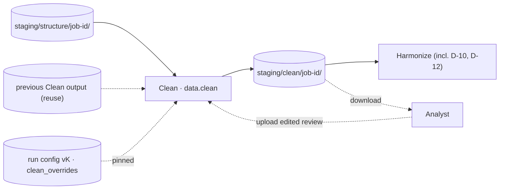

# Spec DP-B — Cell-Level Data Hygiene (Clean)

> **Status:** Proposed (draft for review) · **Version:** 0.3 · **Series:** Data Pipeline phase spec B of 7 (A–G)
>
> **What Phase B receives from Phase A (Structure).** Structure writes one table (Parquet) per real data region of every uploaded file and hands Clean the tables an Analyst *selected* to feed each source — never a raw file, never an unselected table. Per table, Clean reads:
> - **`data.parquet`** — one row per source data row, one column per table column. Every column is stored as **text** (nullable large-string), never a native type: Structure records what it *observed* in a cell (a number, a date, a formula result, an error literal) in one canonical rendering, but never coerces a value to match a type. A number keeps the shortest decimal text that round-trips to the stored double; a date/time cell is written as ISO 8601 text; a boolean is `TRUE`/`FALSE` text; a formula's stored result is rendered by its type; an empty string is `NULL`. Concretely, this means a number Excel stored as a date, `"$1,234.50"`, an `#N/A` string, all arrive at Clean exactly as the source file wrote them — as text, because no step before Clean ever assigns or coerces a type. Besides the table's own columns, every row carries four system columns: `_row_id` (the row's `Row_ID`, see below), `_source_row` (the original Excel row / CSV record number), `_row_hidden` (was the source row hidden), `_row_filtered` (was it hidden by an active AutoFilter), `_outline_level` (its row-outline nesting depth).
> - **`columns.json`** — Structure's own starting observation, per column: `name`, `label`, `letter`, `position`, `groups`, `unit`, a `source_type` block (`dominant` type, a `histogram` of cell kinds seen, the cell's number-format code) and a `profile` block (populated-cell count, fill rate, distinct-value estimate). This is a **starting observation only** — every Clean rule recomputes its own result from the actual values every run and never trusts `columns.json` as final.
> - **`cells.parquet`** — one file per source file, holding two kinds of row: *placements* (populated cells that never made it into any table — titles, notes, footers) and *annotations* (notes attached to specific table cells). The annotations Clean's D-05/D-06/D-07/D-08 read are: `formula_uncached` (a formula cell with no stored result — its `data.parquet` value is `NULL`), `external_link` (a formula referencing another workbook), `broken_reference` (`#REF!` appears in the formula text), and `error` (the cell's stored value is a literal Excel error, e.g. `#DIV/0!`). These annotations are the *only* place these conditions are visible at all: a cell holding `=SUM(#REF!)` reads back as plain `NULL` under any cached-value read of `data.parquet`, so Clean applies policy to what Structure already flagged rather than re-detecting it. Two further annotations, `type_exception` (a cell's parsed kind differs from its column's dominant kind) and `date_out_of_range` (a date serial outside the representable range), are informational hints only — D-04 and D-02 still compute their own result rather than trusting them.
> - **`Row_ID`** — a permanent per-row identifier, one per surviving source row, of the form `{file_key}:{sheet_index}:{table_key}:{row}` (e.g. `3f9c2a7b1e04:0:t1:4`), assigned by Structure and never recomputed downstream — with one documented exception: for a Parquet-format input file, Structure skips its normal table-detection entirely, and Clean itself gives each row `Row_ID = {file_key}:0:t1:{row}` (1-based row position) the first time it reads that raw file. Outside that one case, Row_ID is deterministic (same file bytes + same detected structure ⇒ same id), stable across re-runs as long as the file and its table key don't change, and unique within a source. Clean must preserve every surviving row's `Row_ID` exactly and, for a row it removes, record a tombstone rather than ever reusing that id for a different row.
> - **`layout_id`** — a hash of a table's normalised column-name set (trimmed, lower-cased, inner whitespace collapsed; column order doesn't matter). Two tables — even from different files — that share a `layout_id` are the same export shape. Clean pools its per-column type/format/placeholder decisions by `(layout_id, column)` rather than by individual file (§3.1), because those decisions are really about the shape, not the file.
>
> Reference material only, borrowed from where useful, never a contract this spec must reconcile with: the `data_quality_agent` repo's old Steps 2–3 (`problem_detector.py`, `data_remediation.py`, `quality_report.py`, `settings.yaml`, `pipelines.py`).
>
> **Produces:** cleaned `data.parquet` per table (same `Row_ID`s minus exact duplicates; no column added or removed), `report.json`, a cell-level audit, a needs-review list, `Hygiene_Review.xlsx`. Harmonize reads this instead of Structure's output.
>
> **v0.3 change:** adds D-26 (§4.0, §5) — an optional, Analyst-supplied value-consolidation mapping file (e.g. grouping several raw category values, such as different vehicle-type labels, into one bucket value), applied at the very start of a Clean run. This is a new feature, not present in the old system.
>
> **Replaces:** old Steps 2–3 (`pipelines.py::run_step2/3`: `quality_report.py` → `data_remediation.py`).

---

# 1. Scope

### In scope (V1)
* **`data.clean`**: reads Structure's *selected* tables only — never a raw file, never an unselected table.
* At the **start of every run**, before any table is processed: ask the Analyst whether they have a value-consolidation mapping file for this run; if yes, accept the upload and apply it as D-26 (§4.0) before any of the other twenty rules run.
* The Hygiene rule pack, **`cleaning@x.y.z`** — twenty-one rules (§5): twenty always-available rules plus D-26, which only runs when a mapping file is supplied for that run.
* **All value-level parsing and coercion**: dates Excel misread as numbers (and vice versa), locale-aware currency/number parsing, mixed types, mojibake, leading zeros. `data.parquet` arrives text-only (see above) — there is no step upstream of Clean where a type is ever assigned, so all of it happens here (§2.1).
* Row- and column-level flags: exact-duplicate rows, sign convention, mixed units, precision loss, truncated values, cryptic column names.
* Policy on cells Structure already annotated: a leaked formula, an external-workbook reference, `#REF!`, an Excel error value (§2.4) — Clean decides what to do with each, it doesn't re-detect them.
* **`clean_overrides`**: a real, bounds-validated, runtime-consulted config section (§7) — unlike the old `settings.yaml`, whose equivalent block was loaded and never read (J-13).
* The cell-level audit and the Analyst review loop, `Hygiene_Review.xlsx` (§8) — a loop the old system's own `needs_review.json` promised in its `instructions` field but never built (J-01).
* **Incremental reuse**: an unchanged table is copied from the prior Clean run instead of reprocessed (§10).

### Out of scope
* **Case normalization and near-duplicate identifiers** (old D-10, D-12) → Harmonize, as value mapping.
* **Statistical outliers** (old D-14) → Validate, flag-only.
* **Header whitespace** (D-11) and **file/sheet corruption signals** (D-17) — already handled upstream, before Clean ever sees a table: header text arrives already trimmed, and a corrupted sheet is already flagged before selection. Cross-referenced only, §2.5.
* **Schema and taxonomy mapping** → Phase E. **Unpivoting** → Structure's job; Clean cleans values inside a table without touching its shape.
* **Dropping a column, ever** — including one that is entirely null. The old `fix_d20` did this as an undocumented second job bolted onto mojibake repair (J-19); Clean never removes a column (P1).
* **The client report PDF** — Clean only marks a finding `client_report: true`; the Gate assembles the actual report after Phase D.
* **A core LLM.** All twenty rules are deterministic (§9 covers the one optional exception).

### 1.1 Terms

| Term | Meaning |
|---|---|
| Rule | One of D-01–D-25, minus five moved or cross-referenced away (§2.5), plus D-26; a **fix**, a **flag**, or both |
| Value mapping file | An Analyst-supplied workbook, uploaded at run start, listing which raw values in which columns should be rewritten to which bucket value — D-26's input (§4.0) |
| Fix | Changes a value or removes a row automatically; one audit entry; no review item for a value it resolved |
| Flag | Raises a review item and leaves the value untouched |
| Cross-reference | An old D-code whose logic now lives in Structure, Harmonize or Validate; Clean runs no logic for it |
| Dominant type / format | The most common parsed type or date format in a column, recomputed fresh every run (§4.2) — never hardcoded or carried over |
| Placeholder token | A "no value" string (`"N/A"`, `"TBD"`, …) — *unless* it's the column's own dominant value (§4.4's guard) |
| Needs-review item | One row/column + rule + reason finding; becomes one line of `Hygiene_Review.xlsx` |
| Severity | `info` / `warn` / `block`, this pipeline's shared severity vocabulary. Clean never raises `block` |
| `clean_overrides` | Per-rule `enabled` + bounded params (§7); every key here is actually read, unlike the old config |
| `layout_id` | A hash of a table's normalized column-name set (see above); type/format decisions are learned per layout, not per file (§3.1) |
| Tombstone | An audit entry for a `Row_ID` D-19 removed (§6) |

---

# 2. Where Clean Sits

### 2.1 All value-level parsing happens here, not upstream

No step upstream of Clean ever assigns a type to a value: uploads are ingested unparsed, and Structure's `data.parquet` is a text-only canonical rendering by design (see above) — it records what Structure *observed* in `columns.json` but never coerces a value to match. So a number Excel stored as a date, `"$1,234.50"`, an `#N/A` string — all arrive at Clean exactly as the source file wrote them, as text. Both value-cleaning and all type/format coercion belong to Clean; no other phase does either.

### 2.2 The flow



Clean is an independent `data.clean` job — staging only, nothing sealed until Confirm (G1). **Run remaining steps** re-enters at Clean whenever `clean_overrides` or an upstream table changes (§10).

### 2.3 Principles

| # | Principle |
|---|---|
| P1 | Values change, shape doesn't — no column ever added, removed or renamed; no row added |
| P2 | `Row_ID` is permanent; a removed row is tombstoned (§6), never reused |
| P3 | Every automatic change is audited, including storage-only changes (fixes J-04) |
| P4 | No core LLM — every rule is a deterministic function of values + config |
| P5 | Every configurable threshold is bounds-validated and actually read at run time (fixes J-13/J-14) |
| P6 | One fix/flag classification, one severity, one default per rule, declared once (fixes J-02) |
| P7 | Reproducible: same inputs + config + rule-pack version → byte-identical output |
| P8 | Value-free outside the data plane — only counts/rule-ids/column-names reach Postgres, logs, action items |
| P9 | Streaming and bounded — memory depends on table width, not length |

### 2.4 The seam with Structure's cell annotations

D-05, D-06, D-07 and D-08 detect nothing themselves — they read `cells.parquet`'s per-cell annotations (`formula_uncached`, `external_link`, `broken_reference`, `error`, defined above) and apply policy. This isn't a convenience, it's the only place these are visible at all: a cell holding `=SUM(#REF!)` reads back as plain `null` under any cached-value read, exactly as the golden workbook's `Broken_Formula`/`External_Check` columns demonstrate (fixture F-05). D-08 additionally keeps a text-pattern fallback for its 7 literal error strings, since those *do* survive a cached-value read.

### 2.5 Reconciling the old 25-code checklist

The workflow document's N-01–N-05/E-01 labels **do not exist in the code** — a full-repo search returns zero matches. The code implements only **D-01–D-25** (plus a separate S-01–S-25 for Structure). Mapping: N-01/E-01→D-01, N-02→D-18, N-04→D-09, N-05→D-13. This spec uses D-codes only.

Of the 25, five are not Clean's:

| Code | Old label | Actually lives in | Why |
|---|---|---|---|
| D-10 | Case inconsistency | Harmonize | Value mapping belongs to the harmonization step, not cell hygiene |
| D-11 | Header trailing spaces | Structure (cross-ref) | Structure already trims header text before Clean ever sees it |
| D-12 | Identifier near-duplicates | Harmonize | Value mapping belongs to the harmonization step, not cell hygiene |
| D-14 | Statistical outliers | Validate | Flag-only; belongs with Validate's statistical checks |
| D-17 | File/sheet corruption | Structure (cross-ref) | Structure already raises this before a table is even selectable |

The remaining **twenty** are Clean's rule pack (§5): D-05/06/07/08 apply policy to Structure's annotations; the other sixteen detect and act on column content directly, reading `columns.json`'s observations but computing their own result every run.

---

# 3. Inputs

| File | From | Used for |
|---|---|---|
| `data.parquet` | Structure | The only source of values — text or typed null (see above) |
| `columns.json` | Structure | Starting observation only (type histogram, format, profile) — every rule recomputes its own result from actual values (P7), never trusts this as final |
| `cells.parquet` | Structure | `formula_uncached`/`external_link`/`broken_reference`/`error` annotations, applied not re-detected (§2.4). `type_exception`/`date_out_of_range` are informational hints only for D-04/D-02, which still compute their own result |
| `samples.json` | Structure | Not read — Clean regenerates its own before/after samples (§6) |
| `Row_ID` | `data.parquet` | Join key for every audit/review entry; never recomputed (P2) |
| `layout_id` | `columns.json` | Scopes per-column type/format pooling (§3.1) |
| `clean_overrides` | Pinned run config | Which rules run, params within bounds (§7) |
| Prior Clean output | `staging/clean/{prior_job_id}/` | Reuse check (§10) |

### 3.1 Pooling by `layout_id`, not by file

Several decisions are really about a *layout*, not one file: a date column's format, which type is dominant, what a placeholder means, a mojibake trigger, an expected identifier length. Two files sharing a `layout_id` are the same export shape, so Clean computes these **per `(layout_id, column)` pair**, pooling every selected table sharing that layout in the current run, and records the decision once in `report.json` (§6). Adding more files of the same layout later recomputes the pooled decision from scratch — this can change which value counts as "dominant," which is why a `clean_overrides` change or re-run marks every table sharing a `layout_id` stale together (§10).

This applies to: §4.3's decimal-convention resolution, D-02/D-03's date format, D-04's dominant type, D-18's placeholder guard, D-20's mojibake trigger, D-24's identifier length. It does **not** apply to D-01's numeric-keyword gate (a static column-name match) or D-19's duplicate key (always per-table). Column-level flags with no "dominant" concept (D-15/16/21/22/23) are computed per table.

---

# 4. Processing

### 4.0 Value consolidation via mapping file (D-26)

**At the start of every Clean run**, before any table is read for the other twenty rules, the Analyst is asked one question: *does this run have a value-consolidation mapping file?* This is a plain yes/no prompt on the run-kickoff screen, shown every run (it's not a one-time setting) — a client's mapping needs can change run to run.

- **No** → skip straight to §4.1; nothing about the run changes.
- **Yes** → the Analyst uploads a workbook, one sheet named `Value_Mapping`, three columns:

| Column | Meaning |
|---|---|
| `Column` | Name of the column this row applies to (e.g. `VehicleType`) |
| `Source_Value` | A raw value to match, e.g. `Sedan` |
| `Target_Value` | The bucket value to replace it with, e.g. `Passenger Car`. Blank means "map to null" (an explicit blank-out, not an error) |

Several rows can share one `Column` + `Target_Value` with different `Source_Value`s — that's how many raw values collapse into one bucket (e.g. `Sedan`, `Hatchback`, `4dr Sedan` → `Passenger Car`).

**Upload validation** (rejected before the run starts, with the specific problem named):
- Every row has a non-blank `Column` and `Source_Value`.
- No two rows share the same `Column` + `Source_Value` with a different `Target_Value` (an unambiguous mapping is required — the same raw value can't bucket two different ways in one file).
- A `Column` naming something absent from *every* table in this run is a validation warning, not a hard rejection — the same mapping file may be reused across runs whose tables differ slightly; a row that matches nothing in this particular run is simply inert for it.

**Matching, at Clean time, per table:** for every column in the table whose name matches a `Column` value in the mapping file, compare each cell's value (trimmed, case-folded) against that column's `Source_Value` entries (also trimmed, case-folded). A match rewrites the cell to the mapping's exact `Target_Value` text (not re-normalized) and writes one audit entry (`Row_ID`, `Table`, `Column`, `Rule: D-26`, `Old_Value`, `New_Value`). A cell whose value matches nothing in the file is left completely untouched — the mapping file is opt-in per value; it never needs to be exhaustive.

**Optional: flag stragglers.** When `flag_unmapped` is on (§7, default **on** whenever a mapping file is supplied), after matching runs, every *distinct* value that appeared in a mapped column but matched no `Source_Value` gets one column-level review item (same shape as D-15/D-21's column-level flags, §5) listing those values — so the Analyst can see, this run, which vehicle types (or whatever the category is) weren't covered yet and extend the mapping file next time. This is a flag only; nothing is changed or blocked.

D-26 is a **fix** (for matched values) with an optional **flag** (for stragglers) — it never blocks a run.

### 4.1 Run order

```
0.  D-26              value consolidation from the uploaded mapping file, if any (§4.0)
1.  D-07, D-08        null cells Structure already flagged broken/error
2.  D-09              whitespace
3.  D-13              control characters
4.  D-20              mojibake repair
5.  D-01, D-25        date-serial reconstruction
6.  D-02, D-03        date validity, date format
7.  D-04              mixed types
8.  D-18              placeholders / redacted / missing-identity
9.  D-24              leading zeros
10. D-19              exact-duplicate rows (always last among fixes)
—   D-05, D-06        formula/external-ref policy (order-independent)
—   D-15/16/21/22/23  column-level flags, read-only, run after every fix
```

D-26 runs **first**, ahead of even the broken-cell nulling — a value consolidation is a deliberate, Analyst-authored instruction, not a data-quality correction, so it should see the data exactly as the file wrote it and everything downstream (including D-19's duplicate detection) should see the consolidated result.

Rationale, compressed: null the already-known-broken cells first so nothing downstream sees literal `"#REF!"`; strip noise (whitespace/control chars/mojibake) before anything tries to match or compare values — noise blocks both D-19's duplicate match and D-01/D-04's numeric parse; resolve date-serial mistakes before validating dates; settle mixed-type and placeholder decisions once a column's representation is stable; run duplicate-detection **last** so duplicates that earlier normalization exposes (two rows differing only by whitespace) are still caught. This replaces the old code's undeclared order for 20 of its 25 codes and its bolted-on "safety sweep" (J-16, J-17). Detection and remediation run back-to-back per rule per table — not as two passes through an intermediate JSON file, as the old Step 2/Step 3 split did — closing an entire class of detector/fixer disagreement by construction (J-18 is the clearest case).

### 4.2 Dominant type/format algorithm

One shared algorithm, replacing four independently-reinvented versions (`detect_d04`, `fix_d04`, `fix_d10`, `fix_d24`, each with its own strip set and tie-break — J-06):

1. Every non-null value in the `(layout_id, column)` pool.
2. Classify **numeric-parseable** (§4.3's parser) or **text**.
3. Larger count wins; ties → **text** (coercing text to a number is the costlier mistake).
4. Numeric-dominant → sub-type (integer vs decimal) is whichever `.is_integer()` covers ≥50% — feeds D-04's minority-value judgment for a numeric-dominant column.
5. Date-keyword column (`date`,`week`,`month`,`period`,`day`,`time`) → dominant format is the most common shape a value actually matches (§5, D-03); tie → ISO.

Only genuinely-changing values are audited: compare the value to be *written* against the value *read*, not an intermediate parsed form (fixes J-08's spurious `"5"` vs `"5.0"` entries).

### 4.3 Locale-aware numeric/currency parsing

One shared parser, replacing four different non-locale-aware strip sets (J-07):

1. Strip a recognized currency symbol (`$€£₹¥`, configurable) from either end, then whitespace.
2. **Both** comma and dot present → whichever comes **last** is the decimal point (`"1.234,56"`→EU `1234.56`; `"1,234.56"`→US `1234.56`).
3. **Only a dot** → US/UK, dot is decimal.
4. **Only a comma, last group ≠ 3 digits** → EU, comma is decimal (`"€99,99"`→`99.99`, never `9999` — the case a naive comma-strip gets wrong).
5. **Only a comma, exactly 3 digits after it** (`"1,234"`) → genuinely ambiguous alone (US reads `1234`, EU reads `1.234` — different numbers). Resolved from the column's pooled evidence (§3.1): if any other value in the pool unambiguously shows one convention, every ambiguous value follows it; with no such evidence anywhere, default to US/UK grouping and do **not** flag it as ambiguous — the lower-risk, more common shape in this platform's data.
6. More than one comma **and** more than one dot → unparseable; treated as non-numeric for classification, routed through the calling rule's existing flag path.

Fixture F-06: `Currency_Text` holds both `"$1,234.50"` and `"€99,99"` in the same column — this parser reads both correctly; a naive strip-and-parse would misread the second as `9999`.

### 4.4 Placeholder dominant-value guard

D-18's placeholder match only counts as a placeholder if the token is **not** the column's own dominant value at ≥5% frequency. Concrete reason: `"Pending"` is this list's single most common token, and in the golden workbook's `Status` column it's the legitimate dominant value (1,245 of 1,249 matches) — a dominance-blind rule would null 1,245 correct values to catch 4 real mistakes.

### 4.5 What Clean never does

Case normalization or near-dup resolution (D-10/D-12 — Harmonize); outlier statistics (D-14 — Validate); header whitespace or file corruption (D-11/D-17 — Structure); schema/value mapping (Phase E); any LLM call in detection or remediation (§9).

---

# 5. Rule Catalogue

Severity is `info` or `warn` only — nothing here raises `block`. "Fix" writes a value plus one audit entry; "Flag" raises one needs-review item and leaves the value untouched. Bounds in brackets; a param not listed for a rule isn't configurable for it. D-10/11/12/14/17 are not Clean's (§2.5).

| Code | Rule | Class | Sev | Detection | Remediation | Config (default, bounds) |
|---|---|---|---|---|---|---|
| **D-01** | Numeric stored as date | Fix+Flag | info/warn | Column name matches 1 of 43 numeric keywords (§7) and value fails §4.3's parse; or a date-typed value's year > `far_future_year` | Far-future/M-D-Y match → recompute Excel serial (`(date−1899-12-30).days`), audited; else null+review; whole column rewritten for type consistency, **every** changed value audited (fixes J-04's silent gap, J-05's flagged-never-fixed gap) | `numeric_keywords` (43-item list, §7), `far_future_year` (2100,[2050,2200]) |
| **D-02** | Invalid/bogus dates | Fix+Flag | warn | Date-keyword column; parse vs 4 formats then a `YYYY-MM-DD` regex fallback; year outside `[min_year,max_year]`, or invalid month/day | Impossible day (Feb 30) → clamp to real last day, audited, no review; bad year/month → null + **one** review item (fixes J-03's double-entry) | `min_year` (1900,[1000,2100]), `max_year` (2100,[1900,3000]) |
| **D-03** | Inconsistent date format | Flag+Fix | info | Column shows >1 distinct shape among 7 canonical shapes → column-level finding; a value matching none → separate per-value finding. Compared against the column's own dominant format (§4.2), never read-order (fixes a sibling of J-16) | Value matching the dominant format: untouched. Matching a different recognized shape: reparsed and rewritten to the dominant shape, audited. Matching none: left alone, flag stands. (Replaces the old unconditional-ISO fixer, J-09; an explicit classification fixes J-10) | `date_shapes` (7, ordered list) |
| **D-04** | Mixed data types | Fix+Flag | warn | String column, name not an id-keyword (`id,code,key,ref,identifier`); dominant type (§4.2) numeric, ≥`minority_threshold` non-numeric-parseable. A text-dominant column → **no finding at all** | Numeric-dominant: non-numeric value → null+review; numeric-parseable-but-differently-written → rewritten, audited only if changed (fixes J-08) | `minority_threshold` (0.02,[0.0,0.5]), `id_keywords` (shared with D-24) |
| **D-05** | Formula leaked as value | Flag | warn | Every cell annotated `formula_uncached` — no independent detection (§2.4) | None — 1 review item/cell | `enabled` only |
| **D-06** | External formula reference | Flag | warn | Every cell annotated `external_link` | None — 1 review item/cell | `enabled` only |
| **D-07** | Broken reference `#REF!` | Fix | info | Every cell annotated `broken_reference` | Set `null`, audit with cached text as `old_value` | `enabled` only |
| **D-08** | Excel error value | Fix | info (warn if fallback-only) | Every cell annotated `error`, **plus** a fallback regex over every string value (`#VALUE!,#N/A,#DIV/0!,#NAME?,#NUM!,#NULL!,#ERROR!`, case-insensitive) — these survive a cached-value read | Set `null`, audit with original text | `error_patterns` (7, list; `#REF!` excluded — D-07's) |
| **D-09** | Whitespace | Fix | info | Leading/trailing whitespace, or ≥2 consecutive interior spaces | Trim; collapse interior runs to 1 space | `enabled` only |
| **D-13** | Control characters | Fix | info | ASCII control char (`\x00`–`\x1F`) or DEL | Replace with space, trim, collapse (shares D-09's collapse) | `enabled` only |
| **D-15** | Missing minus signs | Flag (col) | warn | Column name has 1 of 12 sign keywords, ≥`min_ratio` numeric-parseable (§4.3), every non-null value ≥0, ≥`min_values` values | None — 1 column review item | `sign_keywords` (12), `min_values` (3,[1,100]), `min_ratio` (0.8,[0.5,1.0]) |
| **D-16** | Cryptic column name | Flag (col) | info | Name matches, case-sensitively for the all-caps branch: a lowercase-underscore-lowercase **prefix** (`a_b`, matches at the *start* only — unlike the branches below, this one isn't whole-name), an all-**uppercase** 2–6 letter run, `col_123` (whole name), a bare 1–2 letter name (whole name), `_adj`/`_tmp` (suffix), or `_x_` (anywhere) | None — 1 review item/table listing every matching name; the `column` field holds all names joined `", "` (the only rule where it isn't one name), `row_id: null` | `enabled` only |
| **D-18** | Placeholder / redacted / missing-identity | Fix+Flag | info/warn | (1) full-string match vs 1 shared 21-token list (`n/a,na,null,none,--,.,-,missing,test,dummy,sample,placeholder,xxx…,tbd,todo,pending,unknown,delete,temp,fake,mock`), subject to §4.4's guard, skipped on geo-hint columns; (2) redact patterns (`\*{2,}`,`#{2,}`,`[redacted]`,…); (3) `null` in a name/contact/author/creator/brand column with another non-null value in the row | (1) → null + audit; (2) and (3) → flag only | `placeholder_tokens` (21), `dominant_value_threshold` (0.05,[0.0,0.5]), `geo_hints` (6), `identity_keywords` (6) |
| **D-19** | Exact-duplicate rows | Fix | info | Full-row Polars-native equality, not a stringified key (fixes J-18) | Keep the first occurrence, tombstone every other `Row_ID` in the group (§6) | `enabled` only — "exact" leaves nothing to loosen |
| **D-20** | Mojibake | Fix | info | One shared trigger pattern for detect **and** repair (`Ã.`, `â€.`, `Â[^\w]`, `Ð`, `Ñ`, leading BOM) — fixes J-20's mismatched detector/repair regexes | Try `cp1252→utf-8`, fall back `latin-1→utf-8`; keep only if changed. Never drops all-null columns (fixes J-19's undocumented side effect) | `enabled` only |
| **D-21** | Numeric precision loss | Flag (col) | warn | ≥`min_ratio` numeric-parseable; integer part exceeds 15 significant digits (Excel's float limit) | None — 1 column review item | `significant_digit_limit` (15,[10,18]), `min_ratio` (0.8,[0.5,1.0]) |
| **D-22** | Inconsistent units | Flag (col) | warn | ≥`min_ratio` numeric-parseable, ≥5 values, nonzero median; max/min ratio > `ratio_threshold`, all non-negative, splitting at `median_multiplier`×median puts 5–95% in the "high" group | None — 1 column review item with a high-side sample | `ratio_threshold` (50,[5,1000]), `median_multiplier` (10,[2,100]), `bimodal_band` ([0.05,0.95], low∈[0,0.49], high∈[0.51,1]), `min_ratio` (0.8,[0.5,1.0]) |
| **D-23** | Truncated values | Flag (col) | info | String column, max length ≥`min_length`; ≥`at_max_fraction` of values (≥`at_max_min_count`) sit exactly at max length | None — 1 column review item with a sample | `min_length` (10,[1,1000]), `at_max_fraction` (0.15,[0.01,1.0]), `at_max_min_count` (3,[1,100]) |
| **D-24** | Leading zeros stripped | Fix | info | String, id-keyword column name, value matches `^0\d+$` | Pad every value to the column's own modal string length (a float-looking `"7001.0"` is normalized to `"7001"` first) | `id_keywords` (shared with D-04) |
| **D-25** | Date as serial number | Fix | info | Date-keyword column; ≥80% of values parse as integers in `[1,60000]` | Compute the genuine majority *displayed* format (7 shapes, ranges excluded from the tally) from non-serial values; convert serials via `1899-12-30+days`, write only if year∈[1900,2100] | `min_serial` (1,[0,100]), `max_serial` (60000,[10000,200000]), `min_ratio` (0.8,[0.5,1.0]) |
| **D-26** | Value consolidation from mapping file | Fix+Flag | info | Only runs when a mapping file was uploaded this run (§4.0); cell value (trimmed, case-folded) matches a `Source_Value` for its column | Match → rewrite to the file's exact `Target_Value`, audited. Optionally (§7): every distinct unmatched value in a mapped column → 1 column-level review item | `flag_unmapped` (on,[on/off]), `case_sensitive` (off,[on/off]) |

**D-05/06/07/08 can co-occur on one cell** (an external-link formula with no cached result can be both `formula_uncached` and `external_link`) — Clean doesn't deduplicate; each annotation raises its own finding.

---

# 6. Outputs

Under `staging/clean/{job_id}/`: one sub-tree per table, plus run-level `report.json` and `Hygiene_Review.xlsx`.

| Output | Shape |
|---|---|
| `data.parquet` | Same column set and system columns as Structure's table; `Row_ID`s unchanged; no column added or removed |
| `columns.json` (refreshed) | Same schema as Structure's, recomputed against cleaned data — Structure's original is kept for traceability |
| `report.json` | Per table: rules run, counts by rule, per-column dominant-type/placeholder-match summary, needs-review count; run totals; optional `narrative_summary` |
| Audit stream | One entry per fix, keyed by `Row_ID` (not the old positional `(sheet,row,column)`, which breaks the moment D-19 removes a row) |
| Needs-review list | One entry per flag, cell- or column-level |
| `Hygiene_Review.xlsx` | §8 |

`report.json` example:
```json
{
  "job_id": "clean_20260926_1", "rule_pack": "cleaning@1.0.0", "clean_overrides_version": "v7",
  "tables": [{
    "table_ref": "file_ab12:0:t1", "layout_id": "l-9f3c2a7b1e04",
    "row_count_in": 5000, "row_count_out": 4999,
    "counts_by_rule": {"D-09": {"fixed": 3, "flagged": 0}, "D-18": {"fixed": 4, "flagged": 2}, "D-19": {"fixed": 1, "flagged": 0}},
    "columns": {"Status": {"dominant_type": "text", "placeholder_matches": {"Pending": 1245, "NA": 1, "N/A": 1, "null": 1, "None": 1}, "dominant_value_guard_applied": true}},
    "needs_review_count": 6
  }],
  "totals": {"cells_fixed": 0, "rows_dropped": 0, "needs_review_items": 0}, "narrative_summary": null
}
```

**Audit entry:** `{table_ref, row_id, column, rule, action: "fixed"|"dropped"|"analyst_edit", old_value, new_value, timestamp}`. A tombstone (`action: "dropped"`) sets `column: null` and `old_value` to the surviving `Row_ID`; tombstones per table = `row_count_in − row_count_out`.

**Needs-review entry:** `{table_ref, row_id (null if column-level), column, rule, scope: "cell"|"column", current_value, why_flagged, suggested_action, severity}`.

**Before/after preview:** served by filtering the audit's `old_value`/`new_value`, not pre-materialized separately.

**`Row_ID` continuity:** every surviving row keeps its exact `Row_ID`, assigned by Structure and never recomputed by Clean; a D-19-removed row is tombstoned, never reused for a different row.

---

# 7. Configuration: `clean_overrides`

`clean_overrides` is a JSON section of the pipeline's versioned run configuration, following the same draft-then-promoted-version flow as every other step's config section: edits accumulate in a draft, and a **Run remaining steps** or explicit save promotes the draft to a new immutable config version, which is what a job actually pins. Every parameter in §5 declares bounds; the gateway rejects an out-of-bounds value, an unknown rule key, or an unknown param — unlike `settings.yaml`, which loaded these and never consulted them (J-13/J-14). No rule is mandatory — all twenty may be disabled (open question §11, item 6). A new config version marks Harmonize/Validate stale for every table it touches (§10).

```json
{
  "D-01": {"enabled": true, "params": {"numeric_keywords": ["spend","cost","impressions","clicks","views","reach","sessions","conversions","revenue","count","rate","ctr","cpm","cpc","roas","frequency","downloads","installs","engagement","likes","shares","comments","followers","budget","amount","value","traffic","quantity","qty","price","unit","discount","refund","total","fee","balance","weight","age","score","percent","pct","currency","locale"], "far_future_year": 2100}},
  "D-02": {"enabled": true, "params": {"min_year": 1900, "max_year": 2100}},
  "D-04": {"enabled": true, "params": {"minority_threshold": 0.02, "id_keywords": ["id","code","key","ref","identifier"]}},
  "D-18": {"enabled": true, "params": {"placeholder_tokens": ["n/a","na","null","none","--",".","-","missing","test","dummy","sample","placeholder","xxx","tbd","todo","pending","unknown","delete","temp","fake","mock"], "dominant_value_threshold": 0.05, "geo_hints": ["region","country","market","territory","area","location"], "identity_keywords": ["name","influencer","contact","author","creator","brand"]}},
  "D-22": {"enabled": true, "params": {"ratio_threshold": 50.0, "median_multiplier": 10.0, "bimodal_band": [0.05, 0.95], "min_ratio": 0.8}},
  "D-26": {"enabled": true, "params": {"flag_unmapped": true, "case_sensitive": false}}
}
```
Every rule follows the same `{"enabled": bool, "params": {...bounded...}}` shape (§5 gives each rule's full param set); a rule absent from the object runs with its declared defaults. **D-26's `enabled` only matters when a mapping file is uploaded for a run** — with no file, D-26 does nothing regardless of this setting; the setting exists so a mapping file can be attached to a client's standing config while still being turned off for one run without deleting the file.

---

# 8. Analyst Review: `Hygiene_Review.xlsx`

Closes a gap the old code's own `needs_review.json` promised but never built (J-01): its `suggested_action` field described work for a human to do by hand, with no path back into the pipeline short of a full re-run.

| Sheet | Rows | Editable |
|---|---|---|
| `Needs_Review` | One per needs-review item: `Row_ID` (blank if column-level), `Table`, `Column`, `Rule`, `Current_Value`, `Why_Flagged`, `Suggested_Action`, `Decision`, `New_Value` | `Decision` (dropdown: Accept / Reject / New Value), `New_Value` (free text; read only when `Decision = New Value`) |
| `Auto_Fix_Log` | One per audit entry: `Row_ID`, `Table`, `Column`, `Rule`, `Old_Value`, `New_Value` | Read-only |

Download → edit → upload. On upload, the gateway runs a synchronous pre-check: it rejects an upload with an added, removed or reordered row, or an edited read-only cell. Column-level rows (blank `Row_ID`) are matched on `Table`+`Column`+`Rule` instead — unique per column-level flag.

An accepted upload starts a `review_import` job: **Accept** applies a ready fix if one exists (none currently do) else records acknowledgement only; **Reject** records acknowledgement and restores any value the rule had already nulled pending review (D-02/D-04's branches); **New Value** writes the literal replacement. Every applied decision gets one `analyst_edit` audit entry. **Only the touched `Row_ID`s are re-checked** — not the whole table, closing J-01's "re-run everything" gap.

---

# 9. LLM Usage

No core LLM: every rule in §5 is a deterministic function of values and config — verified by direct reading, zero model calls anywhere in the old `problem_detector.py`/`data_remediation.py`. The one optional exception: `report.json`'s `narrative_summary`, a paragraph from a model run locally on the same machine as the rest of this pipeline (no data leaves the machine), **off by default** and never load-bearing — disabled or unavailable, a deterministic template paragraph is used instead. No model or prompt is pinned in V1 (§11, item 7).

---

# 10. Job Contract

| Field | Value |
|---|---|
| Job type | `data.clean` · 1h timeout · 1 retry · `data_step_succeeded` |
| `inputs` | `[{"ref": "staging/structure/{job_id}/", "tables": [...]}]` |
| `params` | `{"rule_packs": {"cleaning": "1.0.0"}, "config_ref": "config/versions/v7.json"}` |
| `outputs` | `staging/clean/{job_id}/`: per-table `data.parquet` + refreshed `columns.json`; run-level `report.json`, audit, needs-review, `Hygiene_Review.xlsx` |
| `step` value | Job records use `step: "clean"`, one of `structure`/`clean`/`harmonize`/`validate` |

**Staleness:** a Clean re-run or `clean_overrides` change marks Harmonize/Validate stale for every table it touches — and, since §3.1 pools decisions by `layout_id`, for every table sharing that `layout_id`, not just the one that changed.

**Column-statistics refresh:** Structure's `columns.json` describes the *uncleaned* column; Clean writes a refreshed copy (same schema) against cleaned data so Harmonize/Validate don't work from a stale histogram. Structure's original is kept for traceability.

**Incremental reuse:** a table reuses its prior Clean output when both its input content hash (Structure's `data.parquet` + `columns.json` + relevant `cells.parquet` slice) and pinned `clean_overrides` version are unchanged. On reuse, `data.parquet`/audit/review entries are copied server-side, no rule runs, `report.json` marks `reused: true`.

**Clean screen:** lists all 20 rules (D-01–D-25 minus 5), each with its toggle, params and last-run rows-affected count; none locked.

**Typical action items for Clean:** `info` duplicate rows dropped (D-19); `warn` sign convention unclear (D-15). Clean never raises `block`. Outlier capping belongs to Validate (D-14), not Clean, and stays flag-only there too.

---

# 11. Known Defects in the Old Steps 2–3

Found by direct reading of the old code; each is corrected in this spec.

| # | Old defect | Fixed in |
|---|---|---|
| J-01 | No real Analyst-decision loop ever existed — `needs_review.json` only asked for a full re-run | §8 |
| J-02 | Five disagreeing "needs review/client" lists existed at once | §5 (one classification per rule) |
| J-03 | D-02 wrote two, inconsistent review entries per flagged cell | §4.1, D-02 |
| J-04 | D-01's "uniformity" rewrite of good dates went completely unaudited | D-01 |
| J-05 | D-01 detector/fixer used different strip sets — `"$1,234"` flagged but never fixed | §4.3, D-01 |
| J-06 | Four independent "what's dominant" algorithms, each different | §4.2 |
| J-07 | Four different, non-locale-aware currency strip sets; no EU decimal-comma logic anywhere | §4.3 |
| J-08 | D-04 logged spurious "coercion" entries for values that never changed | §4.2 |
| J-09 | D-03 normalized to ISO unconditionally, ignoring its own "majority format" docstring; the majority-detection code was dead | D-03 |
| J-10 | D-03's real, running fixer was never added to any classification set | D-03 |
| J-11 | D-15/D-21/D-22 gated on a dtype check the text-first pipeline could never satisfy | §4.3, D-15/21/22 |
| J-12 | D-16's `IGNORECASE` flagged ordinary names (`Spend`, `Brand`, `Vendor`) as cryptic | D-16 |
| J-13 | `settings.yaml`'s `detection:` block loaded, never consulted | §7 |
| J-14 | `settings.yaml`'s `remediation.fixes` toggle map loaded, never consulted | §7 |
| J-15 | D-18 detector/fixer used different placeholder lists | D-18 |
| J-16 | Run order was declared for only 5 of 25 codes; the rest were incidental | §4.1 |
| J-17 | An unconditional "safety sweep" patched over the undeclared order | §4.1 |
| J-18 | D-19 detection (string-key) and remediation (native-equality) could disagree | §5, D-19 |
| J-19 | Mojibake fixer silently dropped any all-null column as a second, undocumented job | D-20 |
| J-20 | Mojibake detector/repair used different trigger regexes (a BOM-only value passed through untouched) | D-20 |
| J-21 | D-20 sat in all three old classification sets simultaneously | D-20 |

Forward notes for the specs that own these codes: **FN-1** (Harmonize/D-12) — the old near-dup algorithm's own docstring example (`"NYC"` ↔ `"New York City"`) isn't actually catchable by its own substring-containment logic. **FN-2** (Structure/D-11) — a code comment claims D-11's function was removed; it wasn't, it's still implemented further down the same file — worth checking Structure's port wasn't written from the comment instead of the code.

---

# 12. Porting Map

| Old function(s) | New rule |
|---|---|
| `detect_d01_wrong_data_type`, `fix_d01` | D-01 |
| `detect_d02_invalid_bogus_dates`, `fix_d02` | D-02 |
| `detect_d03_inconsistent_date_format`, `fix_d03` | D-03 |
| `detect_d04_mixed_data_types`, `fix_d04` | D-04 |
| `detect_d05/06/07/08_*` | D-05/06/07/08 (redefined as annotation policy, §2.4) |
| `detect_d09_whitespace`, `fix_d09` | D-09 |
| `detect_d10_case_inconsistencies`, `fix_d10` | moved to Harmonize |
| `detect_d11_header_trailing_spaces` | cross-ref to Structure |
| `detect_d12_identifier_variations` | moved to Harmonize |
| `detect_d13_special_characters`, `fix_d13` | D-13 |
| `detect_d14_outliers` | moved to Validate |
| `detect_d15…d25` (and their fixers, where they exist) | D-15 through D-25 |
| *(none — new feature)* | D-26, value consolidation via mapping file (§4.0) |
| `_audit_entry`, `_review_entry` | `Row_ID`-keyed audit / needs-review (§6) |
| `AUTO_FIX_IDS`/`REVIEW_QUEUE_IDS`/`CLIENT_REPORT_ISSUES`/`_AUTO_FIXABLE`/`_CLIENT_IDS`/`CLIENT_REPORT_EXCLUDE` | one classification per rule (§5) |
| `settings.yaml`'s dead config blocks | `clean_overrides`, actually read (§7) |
| `report_generator.py` / `client_report_generator.py` | the Gate's single client report |

---

# 13. Acceptance Criteria

1. `data.clean` only reads tables Structure selected; never a raw file or unselected table.
2. Every enabled rule runs, in §4.1's order, on every selected table.
3. A disabled rule changes nothing and raises nothing, for any table.
4. Every `clean_overrides` param is bounds-validated before the run starts; a violation is rejected, never silently ignored (J-13/J-14).
5. Dominant-type/format decisions are recomputed per `(layout_id, column)` pool every run, never cached from a prior run (J-06).
6. §4.3's parser resolves unambiguous US and EU values in the same column correctly in one run (F-06); a genuinely ambiguous value is never guessed.
7. No fix writes a value equal to what it read; every write has exactly one audit entry (J-03/J-04/J-08 closed together).
8. D-18's dominant-value guard leaves F-02's 1,245 `"Pending"` values untouched and nulls exactly the 4 genuine placeholders.
9. D-04/D-24 never fire on an identifier-keyword column (F-04's `Account_Number`, 4,998 text vs 2 numeric-looking, produces zero D-04 findings).
10. D-05/06/07/08 fire only on Structure-annotated cells (plus D-08's literal fallback); F-05's `Broken_Formula`/`External_Check` (null under a cached-value read) still each produce exactly one finding.
11. D-19's tombstoned set exactly matches one shared row-equality pass (J-18); F-07's one duplicate row produces exactly one tombstone.
12. No run ever adds, removes or renames a column, including when D-20 repairs an all-null column (J-19).
13. Every pre-Clean `Row_ID` is either present unchanged or accounted for by one `dropped` audit entry naming the surviving `Row_ID`.
14. `report.json`'s aggregate counts equal the sum of its per-table entries.
15. `Hygiene_Review.xlsx` contains exactly the run's needs-review items; an upload with a structural change is rejected before any job runs.
16. An accepted decision (Accept / Reject / New Value) produces exactly §8's described effect and re-checks only the touched `Row_ID`s.
17. A table with unchanged content hash and `clean_overrides` version is reused, not reprocessed; `report.json` marks it `reused: true`.
18. A `clean_overrides` change or re-run marks Harmonize/Validate stale for every table sharing that table's `layout_id`.
19. Two runs of the same job (same inputs, same config, same rule-pack version) produce byte-identical output (P7).
20. D-16 never flags `Spend`, `Brand`, `Vendor`, `Region`, `Budget`, `Amount` or other ordinary 5–6 letter mixed-case names (J-12).
21. D-15/21/22 fire on a plain-text column that is ≥80% numeric-parseable, confirming none is gated on a dtype `data.parquet` can never produce (J-11).
22. With no mapping file uploaded, D-26 does nothing and the run-start prompt's "No" path changes nothing else about the run.
23. A mapping file with two rows sharing the same `Column`+`Source_Value` but different `Target_Value` is rejected before the run starts, naming the conflicting rows.
24. Every matched value is rewritten to the mapping's exact `Target_Value` text and produces exactly one audit entry; an unmatched value in a mapped column is left byte-identical.
25. With `flag_unmapped` on, every distinct unmatched value in a mapped column appears in exactly one column-level review item; with it off, none do.

---

# 14. Fixtures (from the golden workbook)

`data_quality_structural_issues_5000_rows.xlsx`, `" Sales Raw@Data "` sheet, read here for cell values rather than shape.

| # | Column | Fact | Expected behavior |
|---|---|---|---|
| F-01 | `Customer Name` | 1 padded value; 2 cp1252-as-UTF-8 mojibake names | D-09 trims; D-20 repairs both; 3 audit entries |
| F-02 | `Status` | 1,249 placeholder-pattern matches: 1,245 legitimate `"Pending"`, 4 genuine mistakes | Guard leaves `"Pending"` alone; D-18 nulls exactly the 4 |
| F-03 | `Product` | 5 case/whitespace variants of one product | D-09 trims the padded one; the remaining 4-way case variance is Harmonize's (D-10), not Clean's |
| F-04 | `Account_Number` | 4,998 text values, 2 numeric-looking | D-04 excluded — identifier-keyword column |
| F-05 | `Broken_Formula`,`External_Check`,`Excel_Error` | First two read `null` under a cached-value view; `Excel_Error` has 4 literal error strings | D-07/D-06 each fire once from Structure's annotations; D-08 fixes all 4 literals |
| F-06 | `Currency_Text` | Both `"$1,234.50"` (US) and `"€99,99"` (EU) | §4.3 resolves to `1234.50` and `99.99`, not `9999` |
| F-07 | (row) | 1 exact-duplicate row (`Invoice_ID="INV-100196"`) | D-19 tombstones the later `Row_ID`; `row_count_out = row_count_in − 1` |
| F-08 | `ZIP_Code` | 5-digit strings, some leading-zero | D-24 pads to the column's modal length |

---

# 15. Open Questions

1. Confirm D-10/D-12→Harmonize, D-14→Validate, D-11/D-17→no Clean logic — and that those specs pick these codes up explicitly.
2. Confirm dropping the old "delete all-null columns" behavior entirely, not even as an opt-in.
3. Confirm `Reject` should restore a rule-nulled value, not just acknowledge with the null left in place.
4. Confirm the ambiguous-currency policy (never guess) over a per-source locale hint.
5. Confirm D-16 (flags a column *name*, not values) belongs in Clean at all, vs. Structure.
6. Confirm Clean's severity vocabulary (`info`/`warn`/`block`, Clean never raises `block`) matches the rest of the pipeline's actual severity enum.
7. Build the narrative-summary LLM feature now, or ship template-only and defer it?
8. Confirm no rule should be locked "on" — a deliberate difference from Structure's screen.
9. Confirm the ported thresholds (2% minority, 50× unit ratio, 15% truncation, 15-digit precision, etc.) are worth keeping as defaults vs. re-derived from real client data.
10. Does a mapping file apply only to the run it's uploaded for, or can it be saved as a standing per-client config that's reused (and editable) across runs without re-uploading each time?
11. Should the same mapping file be allowed to target more than one table in a run, or is one file always scoped to one table's columns? §4.0 currently allows a `Column` name to match across every table in the run — confirm that's actually wanted, versus scoping by table too.
12. Does D-26 need its own review-decision loop (like other flag rules' Accept/Reject/New Value in `Hygiene_Review.xlsx`), or is "extend the mapping file and re-run" enough for the straggler values `flag_unmapped` surfaces?

---
