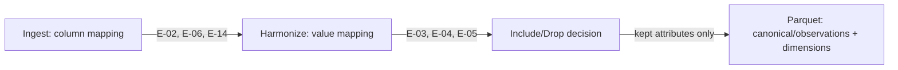

# Spec DP-E — Column & Value Mapping

> **Status:** Proposed · **Version:** 0.3 · **Series:** Data Pipeline phase spec E of 7 (A–G)
>
> **This is a new microservice, designed fresh — none of the mechanisms below are ported from an existing system.** No target-schema file, fuzzy column matcher, or dimension resolver exists anywhere to reuse; every mechanism in this document is this spec's own design.
>
> **Downstream of this phase:** the Pre-Load Checks phase and the DuckDB Loading phase both read this phase's output Parquet. Only columns this phase marks `Include` (§5) reach either of them — a `Drop`ped column is mapped and harmonized but excluded from the Parquet they read.

---

# 1. Scope

| Item | Description | Where it sits |
|---|---|---|
| E-02 | Source column name vs. target schema mismatch | Ingest-time column mapping |
| E-06 | Source attribute present, target column missing | Ingest-time column mapping |
| E-14 | Exact target naming consistency | Ingest-time column mapping |
| E-03 | Foreign-key / dimension mapping | Harmonize-time value mapping |
| E-04 | Unresolved dimension values | Harmonize-time value mapping |
| E-05 | Incorrect dimension-attribute selection | Harmonize-time value mapping |
| *(new)* | Include/drop a mapped attribute from the DB push | Harmonize-time (or later), part of the mapping decision |

### 1.1 Terms
- **Target schema** — the column set this microservice defines for a source kind (e.g. `media_spend` expects `date`, `geography`, `channel`, `campaign`, `spend`). Defined by this service, not inherited from anywhere.
- **Dimension member** — a distinct value within a dimension column (e.g. `"Facebook"`, `"FB"` as members of `channel`) that must resolve to one canonical value before it can be written to the DB's dimension table.
- **Include/drop** — a per-attribute decision, made once at mapping time, about whether a successfully-mapped column reaches the database at all.

---

# 2. Design: Two Mapping Steps

Column-level and value-level mapping are different problems (different granularity, different failure modes), so this spec keeps them as two steps rather than one:

1. **Column mapping (Ingest time).** Every source column is mapped to a target schema column, left unmapped, or explicitly marked "not needed." E-02/E-06/E-14 are checks on this step.
2. **Value mapping (Harmonize time).** For each mapped dimension column, every distinct source value is resolved to a canonical dimension member. E-03/E-04/E-05 are checks on this step.
3. **Include/drop (new, §5).** For every column that passed steps 1–2, the Analyst decides whether it's loaded into the database or kept only as far as the mapped/harmonized Parquet output.

---

# 3. Rule Catalogue

| Code | Rule | Step | Class | Detection | Config |
|---|---|---|---|---|---|
| E-02 | Source column has no schema match | Column mapping | Flag | No confirmed mapping targets a schema column | — |
| E-06 | Target schema column has no source mapped to it | Column mapping | Flag | Required schema column unmapped after confirmation | `required_columns` per source kind |
| E-14 | Confirmed mapping isn't an exact schema-name match | Column mapping | Flag | Mapped target differs from schema's declared name (case/alias) | — |
| E-03 | Dimension value has no canonical match | Value mapping | Flag | Raw value has no exact/fuzzy match in the dimension's member list | `fuzzy_match_threshold` |
| E-04 | Dimension value left unresolved | Value mapping | Flag → Block | Value still unmapped when Harmonize completes | severity configurable per dimension |
| E-05 | Value mapped to the wrong dimension | Value mapping | Flag | Source value mapped outside its expected dimension set | `expected_dimensions` per source kind |

Column mapping and value mapping are both Analyst-driven, assisted by a suggest-a-mapping step (fuzzy name match for columns, fuzzy/exact match for values) — the tool proposes, the Analyst confirms. Nothing here silently picks a mapping.

---

# 4. Analyst Review

One workbook, two tabs — `Mapping_Review.xlsx`:

| Tab | Columns | Editable |
|---|---|---|
| `Column_Mapping` | `Source_Column`, `Suggested_Target`, `Confirmed_Target`, `Status` (E-02/E-06/E-14 flags) | `Confirmed_Target` |
| `Value_Mapping` | `Dimension`, `Source_Value`, `Suggested_Member`, `Confirmed_Member`, `Status` (E-03/E-04/E-05 flags) | `Confirmed_Member` |

Same download → edit → upload discipline as the other phases: headers and row identity (source column name; dimension + source value pair) are locked on upload, so an edit can't add, remove or reorder rows.

---

# 5. New: Include/Drop for the Database Push

### 5.1 Why this exists
Not every attribute that's successfully mapped and harmonized needs to reach the database — a source may carry columns useful for QA or lineage but not for reporting (an internal source ID, a raw free-text note field, a column only needed to disambiguate during mapping itself). Rather than loading everything and filtering downstream, the decision is made once, at mapping time, by the person who already has the most context on what each column means.

### 5.2 Mechanism
Every column that passes column mapping (§3) gets one additional field on the `Column_Mapping` tab:

| Column | Editable | Values |
|---|---|---|
| `Load_To_DB` | Yes | `Include` (default) / `Drop` |

- **`Include`** — the column is written to the mapped/harmonized Parquet output. A later loading phase reads this Parquet and writes every `Include`d column into the database.
- **`Drop`** — the column is still mapped and harmonized (so it's still available in Parquet for lineage/QA), but is not written into the database by the loading phase.

Dropping is a per-**column** decision, not per-row — excluding specific rows (or a whole source's rows) from a given load is a separate, later decision made at load time, not designed in this spec.

### 5.3 Guardrails

Each analytical series (a reporting metric such as Spend, Sales, Impressions) declares which dimension columns together make one of its rows unique — its **grain**. This microservice's grains:

| Series | Grain (dimension columns that must all be present) |
|---|---|
| Spend | Date, Geography, Channel, Campaign |
| Sales | Date, Geography, Brand, Product |
| Volume | Date, Geography, Brand, Product |
| Impressions | Date, Geography, Channel, Campaign, Platform |
| Conversions | Date, Geography, Channel, Platform |

(This table is config, not fixed code — a client's plugin can define its own series and grains; the rows above are the default set.)

- A column another mapped column's grain depends on (e.g. a dimension key another dimension needs to resolve) cannot be set to `Drop` without also dropping the dependent — the upload check must reject an inconsistent combination and say which dependency blocks it.
- Dropping a column that's part of a series' declared grain (the table above) must warn, not silently succeed — that series cannot be loaded correctly without every one of its grain columns present and marked `Include`.

---

# 6. Open Questions

1. Where does "target schema" get defined for this service — a config file per source kind, or a UI the Analyst builds once per client? This spec assumes a config file but doesn't design its format yet.
2. Fuzzy-match method for E-03/E-02 (exact only, edit-distance, or LLM-assisted) — a build decision, not yet made.
3. Block vs. flag for E-04 (unresolved dimension value) — does an unresolved value stop the whole series from loading, or exclude just its rows?
4. Confirm §5.3's default grain table is complete and correct per series before build — it's the basis for the dependency guardrail.
5. Should `Load_To_DB` decisions be revisable per run, or locked once a series has loaded successfully (to avoid a schema that silently shrinks between runs)?

---
